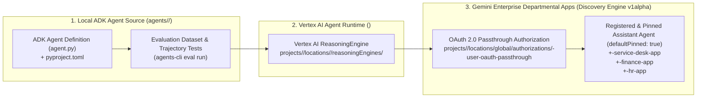

# Agent Publishing Guide: Deploying & Pinning ADK Agents to Google Cloud Gemini Enterprise

This guide provides the complete, step-by-step runbook for **Agent Publishing**—evaluating, deploying, configuring per-user OAuth 2.0 Passthrough, and pinning high-code **Google ADK (Agent Development Kit) Agents** (such as [`agents/universal_skill_orchestrator/`](../../agents/universal_skill_orchestrator/) and [`agents/incident-rca-agent/`](../../agents/incident-rca-agent/)) onto **Vertex AI Agent Engine (`ReasoningEngine`)** and across departmental **Google Cloud Gemini Enterprise (Discovery Engine)** apps.

> **Prerequisite Infrastructure:** Before publishing agents, complete the core enterprise onboarding in the **[Enterprise Deployment Guide (`infra/docs/enterprise-deployment-guide.md`)](./enterprise-deployment-guide.md)**. For governing and publishing `SKILL.md` bundles across apps, see the **[Skill Publishing Guide (`infra/docs/skill-publishing-guide.md`)](./skill-publishing-guide.md)**.

Every step in this guide provides **three execution options**:
1. **Option 1: `gedeploy` Tool (Recommended)** — `./gedeploy --agent-publish --config infra/configs/<CUSTOMER>-onboard.env`
2. **Option 2: Direct Deploy Script with Config File** — `./infra/publish_universal_agent.sh --gcp-project-id <GCP_PROJECT_ID> --all-apps`
3. **Option 3: Manual** — `agents-cli deploy`, `agents-cli publish gemini-enterprise`, and Discovery Engine `v1alpha` REST API calls.

---

## 1. Agent Publishing Architecture & Execution Flow



### Direct Cloud APIs Executed During Agent Publishing

| Phase | Cloud API / CLI Invoked | Purpose |
| :--- | :--- | :--- |
| **1. Agent Runtime Deployment** | Vertex AI `ReasoningEngine` API (`aiplatform.googleapis.com/v1beta1/projects/<GCP_PROJECT_ID>/locations/<GCP_REGION>/reasoningEngines`) via `agents-cli deploy` | Packages the ADK agent container/wheel, deploys it to Vertex AI Agent Runtime, and writes `remote_agent_engine_id` to `deployment_metadata.json` |
| **2. OAuth 2.0 Passthrough Registration** | Discovery Engine `v1alpha` Authorizations API (`POST /v1alpha/projects/<GCP_PROJECT_ID>/locations/global/authorizations?authorizationId=<AUTH_ID>`) | Registers per-user OAuth 2.0 passthrough so the ADK agent executes `:streamAssist` and M365/ServiceNow/Atlassian queries strictly under the calling `@<CUSTOMER_DOMAIN>` user's identity |
| **3. Gemini Enterprise Agent Registration & Pinning** | Discovery Engine `v1alpha` Assistant Agents API (`POST / PATCH /v1alpha/projects/<GCP_PROJECT_ID>/locations/global/collections/default_collection/engines/<APP_ID>/assistants/default_assistant/agents`) | Registers the `ReasoningEngine` as an Assistant Agent on each target Gemini Enterprise App, sets `defaultPinned: true` (pinned alongside **Deep Research**), and configures clickable `starterPrompts` |

---

## 2. Workstation Prerequisites for Agent Publishing (macOS, Linux & Windows)

### 1. Required CLI Binaries

| Tool / Binary | Minimum Version | Purpose | Installation Command (macOS / Linux / Windows) |
| :--- | :--- | :--- | :--- |
| **`python3`** | `>= 3.11` | Runs ADK agent runtime, evaluation suite, and `gedeploy` | **macOS:** `brew install python@3.11`<br/>**Linux:** `sudo apt-get install -y python3 python3-venv python3-pip`<br/>**Windows:** `winget install -e --id Python.Python.3.11` |
| **`gcloud`** | `>= 470.0.0` | Authenticates to Vertex AI Agent Engine and Discovery Engine (`gcloud auth print-access-token`) | **macOS:** `brew install --cask google-cloud-sdk`<br/>**Linux:** [cloud.google.com/sdk/docs/install](https://cloud.google.com/sdk/docs/install)<br/>**Windows:** `winget install -e --id Google.CloudSDK` |
| **`agents-cli` & `uv`** | `agents-cli >= 0.1.0`, `uv >= 0.4.0` | Evaluates, packages, deploys (`agents-cli deploy`), and publishes (`agents-cli publish gemini-enterprise`) ADK agents | **macOS / Linux:** `curl -LsSf https://astral.sh/uv/install.sh \| sh`<br/>**Windows (PowerShell):** `powershell -ExecutionPolicy ByPass -c "irm https://astral.sh/uv/install.ps1 \| iex"` |
| **`jq` & `curl`** | `jq >= 1.6`, `curl >= 7.70` | Constructs and executes Discovery Engine `v1alpha` REST payloads for OAuth passthrough and `defaultPinned: true` | **macOS:** `brew install jq`<br/>**Linux:** `sudo apt-get install -y jq curl`<br/>**Windows:** `winget install -e --id jqlang.jq` |

### 2. Required Python Modules ([`agents/universal_skill_orchestrator/pyproject.toml`](../../agents/universal_skill_orchestrator/pyproject.toml))

- `google-adk[gcp,otel-gcp]>=2.6.0,<3.0.0` *(Google Agent Development Kit runtime & OpenTelemetry GCP exporter)*
- `google-cloud-aiplatform[adk,agent_engines]>=1.129.0` *(Vertex AI `ReasoningEngine` deployment & runtime SDK)*
- `a2a-sdk[http-server]>=1.0,<2` *(Agent-to-Agent protocol server interface)*
- `google-auth>=2.28.0` *(ADC & OAuth credentials)*
- `gcsfs>=2024.11.0` *(GCS filesystem access)*
- `httpx>=0.27.0` and `aiohttp>=3.13.4` *(Async HTTP clients for Discovery Engine `:streamAssist` delegation)*
- `pydantic>=2.6.0` *(Structured tool schemas)*
- `opentelemetry-resourcedetector-gcp<=1.12.0a0` *(Cloud Trace resource detection)*

### 3. One-Time Workstation Setup (macOS / Linux / Windows)

```bash
cd /Users/mohanrajs/aops/geapphub

# 1. Create and activate the Python virtual environment (.venv)
python3 -m venv .venv
source .venv/bin/activate   # On Windows Git Bash: source .venv/Scripts/activate
pip install --upgrade pip

# 2. Install Agent Publishing dependencies
pip install -e agents/universal_skill_orchestrator

# 3. Verify all CLI binaries and Python packages
./gedeploy --check-workstation

# 4. Authenticate Google Cloud CLI & Application Default Credentials
gcloud auth login admin@<CUSTOMER_DOMAIN>
gcloud auth application-default login
```

---

## 3. Step-by-Step Agent Publishing (3 Execution Options)

### Option 1: `gedeploy` Tool (Recommended)

```bash
# 1. Preview Agent Publishing in Dry-Run mode:
./gedeploy --agent-publish --config infra/configs/<CUSTOMER>-onboard.env --dry-run

# 2. Deploy ADK Agents to Vertex AI ReasoningEngine & pin across all customer GE Apps:
./gedeploy --agent-publish --config infra/configs/<CUSTOMER>-onboard.env

# 3. Or pin an already-deployed Vertex AI ReasoningEngine without redeploying the container:
./gedeploy --agent-publish --config infra/configs/<CUSTOMER>-onboard.env --skip-reasoning-engine-deploy

# 4. Or target specific Gemini Enterprise Apps only:
./gedeploy --agent-publish \
  --config infra/configs/<CUSTOMER>-onboard.env \
  --target-apps "<CUSTOMER>-service-desk-app,<CUSTOMER>-finance-app"
```

---

### Option 2: Direct Deploy Script with Config File ([`infra/publish_universal_agent.sh`](../publish_universal_agent.sh))

```bash
cd /Users/mohanrajs/aops/geapphub/infra
set -a && source ./configs/<CUSTOMER>-onboard.env && set +a

# 1. Deploy to Vertex AI Agent Engine & pin across all customer GE Apps:
./publish_universal_agent.sh \
  --gcp-project-id "${GCP_PROJECT_ID}" \
  --region "${GCP_REGION}" \
  --all-apps

# 2. Or publish to a single GE App using an existing ReasoningEngine ID:
./publish_universal_agent.sh \
  --gcp-project-id "${GCP_PROJECT_ID}" \
  --region "${GCP_REGION}" \
  --app-id "<CUSTOMER>-service-desk-app" \
  --skip-reasoning-engine-deploy
```

---

### Option 3: Manual (`agents-cli` CLI & Discovery Engine REST API)

#### Step 3.1: Evaluate & Deploy the ADK Agent to Vertex AI Agent Runtime via `agents-cli`

```bash
cd /Users/mohanrajs/aops/geapphub/agents/universal_skill_orchestrator
export CLOUDSDK_METRICS_ENVIRONMENT=geapphub
export GOOGLE_CLOUD_PROJECT="<GCP_PROJECT_ID>"
export GOOGLE_CLOUD_LOCATION="us-central1"

# 1. Install dependencies & smoke test locally
agents-cli install
agents-cli run "Triage P1 escalation ticket for <CUSTOMER>" --start-server

# 2. Run behavioral & tool-trajectory evaluation
agents-cli eval run tests/eval/eval_config.json

# 3. Deploy to Vertex AI Agent Runtime (writes remote_agent_engine_id to deployment_metadata.json)
agents-cli deploy \
  --project "<GCP_PROJECT_ID>" \
  --region "us-central1" \
  --no-wait

# 4. Check deployment status until SUCCEEDED
agents-cli deploy --status
```

#### Step 3.2: Register OAuth 2.0 Passthrough & Publish Agent to Gemini Enterprise Apps

```bash
cd /Users/mohanrajs/aops/geapphub/agents/universal_skill_orchestrator

# 1. Publish the deployed ReasoningEngine to each target Gemini Enterprise App via agents-cli:
for APP_ID in <CUSTOMER>-service-desk-app <CUSTOMER>-finance-app <CUSTOMER>-hr-app; do
  agents-cli publish gemini-enterprise \
    --project-id "<GCP_PROJECT_ID>" \
    --app-id "${APP_ID}" \
    --app-location "global" \
    --display-name "<CUSTOMER> Enterprise Assistant Agent" \
    --description "Executes governed enterprise workflows using your <CUSTOMER> M365 & GE identity." \
    --authorization-id "projects/<GCP_PROJECT_ID>/locations/global/authorizations/<CUSTOMER>-user-oauth-passthrough" \
    --mode adk
done
```

#### Step 3.3: Pin the Agent (`defaultPinned: true`) via Discovery Engine `v1alpha` REST API

```bash
TOKEN="$(gcloud auth print-access-token)"

curl -sS -X PATCH \
  "https://discoveryengine.googleapis.com/v1alpha/projects/<GCP_PROJECT_ID>/locations/global/collections/default_collection/engines/<CUSTOMER>-service-desk-app/assistants/default_assistant/agents/<AGENT_RESOURCE_ID>?updateMask=defaultPinned,starterPrompts" \
  -H "Authorization: Bearer ${TOKEN}" \
  -H "X-Goog-User-Project: <GCP_PROJECT_ID>" \
  -H "Content-Type: application/json" \
  -d '{
    "defaultPinned": true,
    "starterPrompts": [
      {"text": "Resolve P1 customer escalation using Outlook thread and SharePoint SLA policy"},
      {"text": "Run root-cause analysis on open P1 incidents"}
    ]
  }' | jq .
```

---

## 4. Post-Publishing Verification Checklist

- [ ] **Vertex AI ReasoningEngine Health:** Run `agents-cli deploy --status` and confirm the remote `ReasoningEngine` resource is in `ACTIVE` / `SUCCEEDED` state.
- [ ] **Pinned Assistant in Gemini Enterprise:** Open `<CUSTOMER>-service-desk-app` in Gemini Enterprise and confirm the published Agent appears pinned in the left navigation bar (`defaultPinned: true`) alongside **Deep Research** with clickable starter prompts.
- [ ] **Per-User OAuth 2.0 Passthrough:** Invoke a prompt on the pinned Agent as `alice@<CUSTOMER_DOMAIN>` and verify that downstream `:streamAssist` and M365/ServiceNow/Atlassian tool calls execute strictly under `alice@<CUSTOMER_DOMAIN>`'s ACLs.
