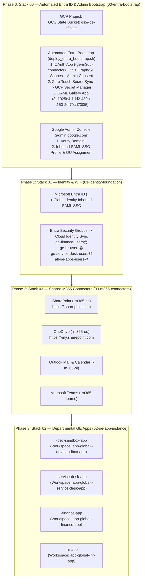
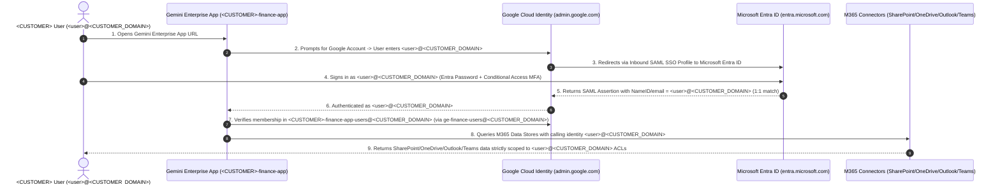

# Enterprise Deployment & Customer Onboarding Guide: Google Cloud Gemini Enterprise + Microsoft 365 & Entra ID SSO (`<CUSTOMER>` Reference)

This unified guide provides the complete, copy-pasteable step-by-step deployment and customer onboarding procedure for **Google Cloud Gemini Enterprise (Discovery Engine)** integrated with **Microsoft Entra ID (`entra.microsoft.com` SAML 2.0 SSO + Group Sync)**, **Google Admin Console (`admin.google.com`)**, **Microsoft 365 Connectors (SharePoint Online, OneDrive, Outlook, Microsoft Teams)**, **Modular Terraform Stacks (00, 01, 02, 03, 03B, 03C)**, and optional **ServiceNow** and **Atlassian Jira/Confluence** connectors—using **<CUSTOMER> (`<CUSTOMER_DOMAIN>`)** as the reference enterprise implementation.

> **Companion Publishing Guides:**
> * **Agent Publishing:** To deploy and pin ADK Agents onto Vertex AI Agent Engine and Gemini Enterprise Apps, see the **[Agent Publishing Guide (`infra/docs/agent-publishing-guide.md`)](./agent-publishing-guide.md)**.
> * **Skill Publishing:** To benchmark, govern, and share `SKILL.md` bundles across Gemini Enterprise Apps, see the **[Skill Publishing Guide (`infra/docs/skill-publishing-guide.md`)](./skill-publishing-guide.md)**.

Every step gives you **three execution choices**:
1. **Option 1: `gedeploy` Tool (Recommended)** — Direct Terraform & Cloud API CLI (`./gedeploy --config infra/configs/<CUSTOMER>-onboard.env ...`).
2. **Option 2: Direct Deploy Scripts with Config File** — Modular shell orchestrators (`./infra/deploy_*.sh --config ...`).
3. **Option 3: Manual** — Admin Portal UI / raw `terraform`, `gcloud`, `az`, and `curl` REST commands.

---

## 1. Target Architecture, Onboarding Sequence & Customer Discovery Checklist



### End-to-End Authentication & 1:1 ACL Enforcement Flow (`<CUSTOMER_DOMAIN>`)



### Pre-Deployment Customer Discovery Checklist & <CUSTOMER> Reference Values

Collect these **10 parameters** in [`infra/configs/<CUSTOMER>-onboard.env`](../configs/examples/onboard.env.example) (template at [`infra/configs/examples/onboard.env.example`](../configs/examples/onboard.env.example)) before starting the deployment:

| # | Parameter | Variable Name in `<CUSTOMER>-onboard.env` | <CUSTOMER> Reference Value |
| :- | :--- | :--- | :--- |
| 1 | **Customer Slug / Name** | `CUSTOMER_NAME` / `CUSTOMER_COMPANY_NAME` | `<CUSTOMER>` / `<CUSTOMER>` |
| 2 | **Corporate Identity Domain** | `CUSTOMER_DOMAIN` / `PRIMARY_CUSTOMER_DOMAIN` | `<CUSTOMER_DOMAIN>` *(Initial Entra Tenant: `<CUSTOMER>.onmicrosoft.com`)* |
| 3 | **GCP Project ID & Region** | `GCP_PROJECT_ID` / `GCP_REGION` / `GE_LOCATION` | `<GCP_PROJECT_ID>` / `us-central1` / `global` |
| 4 | **GCP Organization ID** | `GCP_ORG_ID` | `123456789012` *(auto-discovered in Step 2 if left blank)* |
| 5 | **Cloud Identity Customer ID** | `CLOUD_IDENTITY_CUSTOMER_ID` | `customers/C01234567` *(auto-discovered in Step 2 if left blank)* |
| 6 | **Remote Terraform State Bucket** | `TF_STATE_BUCKET` | `<CUSTOMER>-ge-tfstate` |
| 7 | **Microsoft Entra Tenant ID** | `M365_TENANT_ID` | `xxxxxxxx-xxxx-xxxx-xxxx-xxxxxxxxxxxx` |
| 8 | **SharePoint Online Root URL** | `M365_SHAREPOINT_INSTANCE_URI` | `https://<CUSTOMER>.sharepoint.com` |
| 9 | **OneDrive Root URL** | `M365_ONEDRIVE_INSTANCE_URI` | `https://<CUSTOMER>-my.sharepoint.com` |
| 10 | **Departmental GE Apps** | `DEPARTMENT_APPS` | `<CUSTOMER>-dev-sandbox-app`, `<CUSTOMER>-service-desk-app`, `<CUSTOMER>-finance-app`, `<CUSTOMER>-hr-app` |

---

## 2. Easy Step-by-Step Onboarding Guide (`gedeploy` CLI)

[`gedeploy`](../gedeploy) ([`infra_deploy_cli/cli.py`](../../infra_deploy_cli/cli.py)) runs the **Terraform stacks** (`terraform init`, `terraform workspace`, `terraform plan`, `terraform apply`) and **Google Cloud / Discovery Engine / Cloud Identity / Microsoft Entra ID APIs** **directly from the CLI**—with **zero web server or middleware API layer required**.

By default, customer onboarding consists of **7 Core Steps** (GCP Foundation $\rightarrow$ Google Admin & SAML $\rightarrow$ Microsoft Entra ID $\rightarrow$ Directory Sync $\rightarrow$ Identity Groups $\rightarrow$ M365 Connectors $\rightarrow$ Departmental GE Apps). Third-party ITSM/ALM connectors (**ServiceNow** and **Atlassian Jira/Confluence**) are **optional parameters** (`--with-servicenow`, `--with-atlassian`) that are disabled by default and only run when explicitly requested.

### Core Step-by-Step Onboarding Matrix (Steps 1 to 7 — Enabled by Default)

| Step | `gedeploy` CLI Command | Direct Terraform Stack & Cloud APIs Executed | What It Configures |
| :--- | :--- | :--- | :--- |
| **Step 1** | `./gedeploy --gcp-foundation` | `gcloud services enable` (14 APIs) + `gcloud storage buckets` | Enables Discovery Engine, Cloud Identity, Admin SDK, Secret Manager, Vertex AI, Agent Registry & Cloud DNS APIs; creates versioned `gs://<CUSTOMER>-ge-tfstate` |
| **Step 2** | `./gedeploy --google-admin` | Admin SDK Directory API + Site Verification API + Cloud DNS TXT + Cloud Identity SAML SSO API | Auto-discovers `CLOUD_IDENTITY_CUSTOMER_ID`, `GCP_ORG_ID` & Root OU; verifies `<CUSTOMER_DOMAIN>` via DNS TXT; creates & assigns Inbound SAML SSO Profile |
| **Step 3** | `./gedeploy --entra-bootstrap` | Terraform Stack 00 ([`00-entra-bootstrap`](../stacks/00-entra-bootstrap/main.tf)) + Microsoft Graph API + GCP Secret Manager | Creates Entra OAuth App (`<CUSTOMER>-ge-m365-connector`), attaches **49 Graph/SharePoint permissions**, grants Admin Consent, syncs secret to Secret Manager, and configures SAML 2.0 Gallery App + 5 Department Security Groups |
| **Step 4** | `./gedeploy --directory-sync` | Cloud Identity Directory Sync API + Discovery Engine `v1alpha` `userStores` API | Validates Entra $\rightarrow$ Cloud Identity Directory Sync and enables automatic Gemini Enterprise seat license assignment |
| **Step 5** | `./gedeploy --identity-terraform` | Terraform Stack 01 ([`01-identity-foundation`](../stacks/01-identity-foundation/main.tf)) + Cloud Identity Groups & SAML API | Syncs Entra Security Groups 1:1 into Cloud Identity, nests them into per-app access groups, and completes the X.509 SAML SSO certificate handshake |
| **Step 6** | `./gedeploy --m365-connectors` | Terraform Stack 03 ([`03-m365-connectors`](../stacks/03-m365-connectors/main.tf)) + Discovery Engine `v1alpha` `DataConnector` API | Provisions shared M365 connectors (`<CUSTOMER>-m365-sp`, `<CUSTOMER>-m365-od`, `<CUSTOMER>-m365-ol`, `<CUSTOMER>-m365-teams`) in `FEDERATED` + `ACTIONS` mode |
| **Step 7** | `./gedeploy --ge-apps` | Terraform Stack 02 ([`02-ge-app-instance`](../stacks/02-ge-app-instance/main.tf)) + Discovery Engine `v1alpha` Engine, Widget, ACL & Model Armor APIs | Provisions <CUSTOMER>'s 4 departmental GE Apps (`<CUSTOMER>-dev-sandbox-app`, `<CUSTOMER>-service-desk-app`, `<CUSTOMER>-finance-app`, `<CUSTOMER>-hr-app`) from the **16-Point Master App Template** |

---

### Step-by-Step Execution Guide (Run Step by Step or All at Once)

> **Single Customer Config File (`infra/configs/<CUSTOMER>-onboard.env`):**
> You only edit **one** file in [`infra/configs/<CUSTOMER>-onboard.env`](../configs/examples/onboard.env.example) (template at [`infra/configs/examples/onboard.env.example`](../configs/examples/onboard.env.example)). All intermediate per-stack `.env` files (`<CUSTOMER>-identity.env`, `<CUSTOMER>-m365.env`, `<CUSTOMER>-*-app.env`, `<CUSTOMER>-servicenow.env`, `<CUSTOMER>-atlassian.env`) are auto-generated behind the scenes inside the hidden `infra/configs/.generated/` folder.

#### Workstation Prerequisites (CLIs, Terraform Providers, Python Runtime & Modules)

##### 1. Required CLI Binaries & System Tools (macOS, Linux & Windows)

> **Windows Workstation Note:** On Windows 10/11, install the CLI tools below via **Winget** (or Chocolatey) in PowerShell, and run `gedeploy` and the `.sh` orchestrators inside **WSL2 (Ubuntu)** or **Git Bash** (installed with Git for Windows).

| Tool / Binary | Minimum Version | Required For | Purpose in `gedeploy` | Installation Command (macOS / Linux / Windows) |
| :--- | :--- | :--- | :--- | :--- |
| **`python3`** | `>= 3.11` | **Core Steps 1–7** & Optional Connectors | Runs [`gedeploy`](../gedeploy) ([`infra_deploy_cli/cli.py`](../../infra_deploy_cli/cli.py)) and inline JSON/PEM parsers in bootstrap scripts | **macOS:** `brew install python@3.11`<br/>**Linux:** `sudo apt-get install -y python3 python3-venv python3-pip`<br/>**Windows:** `winget install -e --id Python.Python.3.11` |
| **`gcloud`** *(Google Cloud SDK)* | `>= 470.0.0` | **Core Steps 1–7** | Enables GCP APIs (`gcloud services enable`), creates GCS state bucket (`gcloud storage`), mints OAuth bearer tokens (`gcloud auth print-access-token`), manages Cloud DNS & Secret Manager | **macOS:** `brew install --cask google-cloud-sdk`<br/>**Linux:** [cloud.google.com/sdk/docs/install](https://cloud.google.com/sdk/docs/install)<br/>**Windows:** `winget install -e --id Google.CloudSDK` |
| **`az`** *(Microsoft Azure CLI)* | `>= 2.55.0` | **Step 3 (`--entra-bootstrap`)**, **Step 4 (`--directory-sync`)**, **Step 6 (`--m365-connectors`)** | Authenticates `hashicorp/azuread` Terraform provider and executes `az rest` Microsoft Graph API v1.0 calls (OAuth App, 49 permissions, Admin Consent, SAML Gallery App) | **macOS:** `brew install azure-cli`<br/>**Linux:** `curl -sL https://aka.ms/InstallAzureCLIDeb \| sudo bash`<br/>**Windows:** `winget install -e --id Microsoft.AzureCLI` |
| **`terraform`** | `>= 1.5.0` | **Step 3, Step 5, Step 6, Step 7** & Optional Connectors | Provisions Stack 00 (`00-entra-bootstrap`), Stack 01 (`01-identity-foundation`), Stack 02 (`02-ge-app-instance`), Stack 03 (`03-m365-connectors`), Stack 03B (`terraform-servicenow`), and Stack 03C (`terraform-atlassian`) | **macOS:** `brew tap hashicorp/tap && brew install hashicorp/tap/terraform`<br/>**Linux:** `sudo apt-get install -y terraform`<br/>**Windows:** `winget install -e --id Hashicorp.Terraform` |
| **`jq`** | `>= 1.6` | **Core Steps 1–7** & Optional Connectors | Parses and constructs REST API JSON payloads for Discovery Engine `v1alpha`, Cloud Identity, Secret Manager, Microsoft Graph, ServiceNow, and Atlassian | **macOS:** `brew install jq`<br/>**Linux:** `sudo apt-get install -y jq`<br/>**Windows:** `winget install -e --id jqlang.jq` |
| **`curl`** | `>= 7.70` | **Core Steps 1–7** & Optional Connectors | Executes authenticated REST API calls (`setUpDataConnectorV2`, `inboundSamlSsoProfiles`, `userStores`, `siteVerification`, `admin/directory/v1`) | **macOS:** Pre-installed<br/>**Linux:** `sudo apt-get install -y curl ca-certificates`<br/>**Windows:** Pre-installed in Windows 10/11 & Git Bash (`curl.exe`) |
| **`bash` & POSIX Utils** | `bash >= 4.0` (`zsh` / WSL2 / Git Bash), `base64`, `sed`, `awk`, `zip` | **Core Steps 1–7** & Optional Connectors | Executes modular shell orchestrators (`infra/*.sh`) and encodes Secret Manager / SAML X.509 payloads | **macOS:** `brew install bash coreutils zip`<br/>**Linux:** `sudo apt-get install -y bash coreutils sed gawk zip`<br/>**Windows:** `wsl --install -d Ubuntu` *(Recommended)* or `winget install -e --id Git.Git` *(Git Bash)* |

##### 2. Terraform Providers (Automatically Installed by `terraform init`)

When `gedeploy` runs each Terraform stack, `terraform init` automatically downloads the required providers from `registry.terraform.io`:

| Terraform Provider | Version Constraint | Used By Stack(s) | Purpose |
| :--- | :--- | :--- | :--- |
| **`hashicorp/google`** | `>= 5.0.0` | All Stacks (`00`, `01`, `02`, `03`, `03B`, `03C`) | Manages GCP APIs, Discovery Engine (`google_discovery_engine_search_engine`, `google_discovery_engine_data_store`), Cloud Identity Groups/Memberships, Cloud DNS TXT records, Secret Manager, and IAM |
| **`hashicorp/google-beta`** | `>= 5.0.0` | Stacks `01`, `02`, `03` | Manages beta Discovery Engine and Cloud Identity resources |
| **`hashicorp/azuread`** | `>= 2.47.0` | Stack `00` (`00-entra-bootstrap`) | Manages Microsoft Entra ID OAuth 2.0 Application (`azuread_application`), 49 Graph/SharePoint App Roles & Scopes, Admin Consent (`azuread_app_role_assignment`, `azuread_service_principal_delegated_permission_grant`), SAML 2.0 Gallery App, X.509 signing certificate, and Department Security Groups |
| **`hashicorp/null`** | `>= 3.2.0` | Stacks `01`, `02`, `03` | Triggers post-provisioning Discovery Engine `v1alpha` REST hooks when Terraform state changes |

##### 3. Python Runtime & Required Python Packages

- **Core `gedeploy` CLI (`infra_deploy_cli/cli.py`) — Core Steps 1 to 7 & Optional Connectors:**
  - Uses **Python `>= 3.11` Standard Library only** (`argparse`, `dataclasses`, `json`, `os`, `pathlib`, `shlex`, `subprocess`, `sys`, `typing`).
  - **Zero third-party `pip` packages are required** to run `./gedeploy --list`, `./gedeploy --onboard`, or any of **Core Steps 1–7** (`--gcp-foundation` through `--ge-apps`) and **Optional Connectors** (`--servicenow-*`, `--atlassian-*`, `--seed-demo-csv`).
  - *(For additional Python modules needed only when publishing Agents or Skills, see the **[Agent Publishing Guide](./agent-publishing-guide.md)** and **[Skill Publishing Guide](./skill-publishing-guide.md)**).*

##### 4. One-Time Workstation Setup & Pre-Flight Verification Commands (macOS / Linux / Windows)

**A. Windows PowerShell (One-Time Prerequisite Install via `winget`):**
```powershell
# Run in an Administrator PowerShell window on Windows 10/11:
winget install -e --id Python.Python.3.11
winget install -e --id Google.CloudSDK
winget install -e --id Microsoft.AzureCLI
winget install -e --id Hashicorp.Terraform
winget install -e --id jqlang.jq
winget install -e --id Git.Git

# Recommended: Install WSL2 Ubuntu (or open Git Bash) to run gedeploy and .sh scripts:
wsl --install -d Ubuntu
```

**B. macOS / Linux / Windows (WSL2 or Git Bash) — Environment Setup & Pre-Flight Verification:**
```bash
cd /Users/mohanrajs/aops/geapphub

# 1. Verify all Workstation CLI binaries, Terraform & Python runtime in 1 command
./gedeploy --check-workstation

# 2. Authenticate to Microsoft Entra ID and Google Cloud
az login --tenant "<CUSTOMER_DOMAIN>"
gcloud auth login admin@<CUSTOMER_DOMAIN>
gcloud auth application-default login

# 3. View all 7 Core Onboarding Steps and Optional Add-On Parameters
./gedeploy --list
```

#### 3 Execution Options for Every Step (`Option 1: gedeploy Tool`, `Option 2: Direct Deploy Script with Config File`, `Option 3: Manual`)

Every step in this guide can be executed using any of the 3 options below:

##### Option 1: `gedeploy` Tool (Recommended — Step-by-Step or 1-Command Full Onboard)
Append `--dry-run` to any command below to preview the exact Terraform plan and Cloud API calls before applying:

```bash
# Run Step-by-Step (Steps 1 to 7):
# Step 1: Enable 14 GCP APIs & create versioned remote Terraform state bucket (gs://<CUSTOMER>-ge-tfstate)
./gedeploy --gcp-foundation --config infra/configs/<CUSTOMER>-onboard.env

# Step 2: Google Admin Console, Domain DNS TXT Verification & Cloud Identity SAML SSO Profile
./gedeploy --google-admin --config infra/configs/<CUSTOMER>-onboard.env

# Step 3: Microsoft Entra ID OAuth App (49 Permissions + Admin Consent) & SAML 2.0 Gallery App (Terraform Stack 00)
./gedeploy --entra-bootstrap --config infra/configs/<CUSTOMER>-onboard.env

# Step 4: GCP Directory Sync Configuration & Gemini Enterprise UserStore License Sync
./gedeploy --directory-sync --config infra/configs/<CUSTOMER>-onboard.env

# Step 5: Terraform Stack 01 — Cloud Identity Per-App Group Nesting & SAML Handshake
./gedeploy --identity-terraform --config infra/configs/<CUSTOMER>-onboard.env

# Step 6: Terraform Stack 03 — Shared M365 Connectors (SharePoint, OneDrive, Outlook, Teams)
./gedeploy --m365-connectors --config infra/configs/<CUSTOMER>-onboard.env

# Step 7: Terraform Stack 02 — Departmental Gemini Enterprise Apps (16-Point Master App Template)
./gedeploy --ge-apps --config infra/configs/<CUSTOMER>-onboard.env

# Or run all 7 Core Steps in 1 command:
./gedeploy --onboard --config infra/configs/<CUSTOMER>-onboard.env --dry-run
./gedeploy --onboard --config infra/configs/<CUSTOMER>-onboard.env
```

##### Option 2: Direct Deploy Scripts with Config File (`infra/*.sh`)
```bash
cd /Users/mohanrajs/aops/geapphub/infra

# Full Core Onboarding via master shell script with config file:
./onboard_customer.sh --config ./configs/<CUSTOMER>-onboard.env --dry-run
./onboard_customer.sh --config ./configs/<CUSTOMER>-onboard.env

# Or run each stack script directly with its config file:
# Step 1 (GCP APIs & State Bucket):
./onboard_customer.sh --config ./configs/<CUSTOMER>-onboard.env --only-phases 0C
# Step 2 (Google Admin & SAML Bootstrap -> generates configs/.generated/<CUSTOMER>-identity.env):
./deploy_google_admin_bootstrap.sh --customer-name <CUSTOMER> --customer-domain <CUSTOMER_DOMAIN> --gcp-project-id <GCP_PROJECT_ID>
# Step 3 (Microsoft Entra ID OAuth & SAML Bootstrap):
./deploy_entra_bootstrap.sh --tenant-id "<entra-tenant-uuid>" --customer-name <CUSTOMER> --customer-domain <CUSTOMER_DOMAIN> --gcp-project-id <GCP_PROJECT_ID> --mode terraform
# Step 4 (GCP Directory Sync & License Sync):
./deploy_gcp_directory_sync.sh --config ./configs/.generated/<CUSTOMER>-identity.env --manifest-out ./configs/.generated/<CUSTOMER>-gcp-directory-sync.json
# Step 5 (Cloud Identity Group Nesting & SAML Handshake — Stack 01):
TF_WORKSPACE_OVERRIDE="id-<CUSTOMER_DOMAIN>" ./deploy_identity.sh --config ./configs/.generated/<CUSTOMER>-identity.env
# Step 6 (Shared M365 Connectors — Stack 03):
TF_WORKSPACE_OVERRIDE="m365-global-<CUSTOMER>-m365" ./deploy_m365.sh --config ./configs/.generated/<CUSTOMER>-m365.env
# Step 7 (Departmental GE Apps — Stack 02):
./create_app_from_template.sh --app-id <CUSTOMER>-service-desk-app --app-display-name "<CUSTOMER> Service Desk Assistant" --customer-name <CUSTOMER> --customer-domain <CUSTOMER_DOMAIN> --gcp-project-id <GCP_PROJECT_ID> --access-group "ge-service-desk-users@<CUSTOMER_DOMAIN>"
```

##### Option 3: Manual (Portal UI & Raw CLI/REST Commands)
Every step section below also includes a **Manual (Option 3)** walkthrough covering the exact clicks in `entra.microsoft.com`, `admin.google.com`, and Google Cloud Console (plus raw `gcloud` / `az` / `curl` commands).

---

### Optional Connector Parameters (ServiceNow, Atlassian & Sandbox CSV)

**ServiceNow**, **Atlassian (Jira Cloud & Confluence Cloud)**, and **Sandbox CSV Seeding** are **optional add-on parameters** (`default_enabled=False`). You can include any of them during full onboarding using `--with-*` flags, or deploy them individually at any time.

| Optional Parameter / CLI Flag | Module Name | Direct Terraform Stack & Cloud APIs Executed | What It Configures |
| :--- | :--- | :--- | :--- |
| **`--with-servicenow`** | Enables both ServiceNow modules below | ServiceNow REST API + Secret Manager + Terraform Stack 03B | Runs both `--servicenow-bootstrap` and `--servicenow-connector` during `--onboard` (or standalone) |
| **`--servicenow-bootstrap`** | `servicenow-bootstrap` | ServiceNow Table REST API (`sys_user`, `sys_user_has_role`, `oauth_entity`) + GCP Secret Manager | Creates ServiceNow Integration User (`<CUSTOMER>.ge.integration`), ITSM/KB/Catalog roles, OAuth 2.0 client & Secret Manager secret (`<CUSTOMER>-servicenow-connector-credentials`) |
| **`--servicenow-connector`** | `servicenow-connector` | Terraform Stack 03B ([`infra/terraform-servicenow`](../terraform-servicenow)) + Discovery Engine `v1alpha` DataConnector API | Provisions shared ServiceNow Connector (`<CUSTOMER>-servicenow`) in `FEDERATED` + `ACTIONS` mode (`knowledge_base`, `incident`, `service_catalog`) |
| **`--with-atlassian`** | Enables both Atlassian modules below | Atlassian REST API v3 + Secret Manager + Terraform Stack 03C | Runs both `--atlassian-bootstrap` and `--atlassian-connectors` during `--onboard` (or standalone) |
| **`--atlassian-bootstrap`** | `atlassian-bootstrap` | Atlassian Cloud Tenant Info API + Jira/Confluence REST API v3 + GCP Secret Manager | Auto-discovers Atlassian Cloud ID (`_edge/tenant_info`), validates OAuth 2.0 (3LO) credentials & syncs to Secret Manager (`<CUSTOMER>-atlassian-connector-credentials`) |
| **`--atlassian-connectors`** | `atlassian-connectors` | Terraform Stack 03C ([`infra/terraform-atlassian`](../terraform-atlassian)) + Discovery Engine `v1alpha` DataConnector API | Provisions shared Atlassian Cloud Connectors (`<CUSTOMER>-jira-fed`, `<CUSTOMER>-confluence-fed`) in `FEDERATED` + `ACTIONS` mode |
| **`--seed-demo-csv`** | `seed-demo-csv` | Cloud Identity Groups Memberships REST API (`v1/groups/*/memberships`) | Optional sandbox CSV user/group membership seeding (`--members-csv`) when live SCIM Directory Sync is not yet active |

#### Examples: Enabling Optional Connectors (ServiceNow & Atlassian)
```bash
# 1. Include ServiceNow and/or Atlassian during Full Onboarding:
./gedeploy --onboard --with-servicenow --config infra/configs/<CUSTOMER>-onboard.env --dry-run
./gedeploy --onboard --with-atlassian  --config infra/configs/<CUSTOMER>-onboard.env --dry-run
./gedeploy --onboard --with-servicenow --with-atlassian --config infra/configs/<CUSTOMER>-onboard.env

# 2. Or deploy ServiceNow as an Optional Add-On at any time:
./gedeploy --servicenow-bootstrap \
  --config infra/configs/<CUSTOMER>-onboard.env \
  --servicenow-instance-uri "https://gcpconnector3.service-now.com" \
  --servicenow-admin-user "admin"

./gedeploy --servicenow-connector \
  --config infra/configs/<CUSTOMER>-onboard.env \
  --servicenow-instance-uri "https://gcpconnector3.service-now.com"

# 3. Or deploy Atlassian (Jira Cloud & Confluence Cloud) as an Optional Add-On at any time:
./gedeploy --atlassian-bootstrap \
  --config infra/configs/<CUSTOMER>-onboard.env \
  --atlassian-instance-uri "https://mohanrajs-team.atlassian.net" \
  --atlassian-admin-email "admin@<CUSTOMER_DOMAIN>"

./gedeploy --atlassian-connectors \
  --config infra/configs/<CUSTOMER>-onboard.env \
  --atlassian-instance-uri "https://mohanrajs-team.atlassian.net"

# 4. Optional Sandbox CSV Group Membership Seeding:
./gedeploy --seed-demo-csv \
  --config infra/configs/<CUSTOMER>-onboard.env \
  --members-csv infra/configs/<CUSTOMER>_users_groups.csv
```

---

## Step 3 (Core Identity — Phase 0A): Microsoft Entra ID Configuration (`--entra-bootstrap` / `deploy_entra_bootstrap.sh` / Manual)

You must configure **two** objects in Microsoft Entra ID for `<CUSTOMER_DOMAIN>`:
1. An **App Registration (OAuth 2.0)** (`<CUSTOMER>-ge-m365-connector`) with all 49 Microsoft Graph & SharePoint permissions and Tenant-Wide Admin Consent for the M365 Data Connectors and Microsoft Graph Group Sync.
2. An **Enterprise Application (SAML 2.0)** from the Entra Gallery (`Google Cloud / G Suite Connector by Microsoft`, Template ID `8b1025e4-1dd2-430b-a150-2ef79cd700f5`) to redirect Google Cloud / Gemini Enterprise login to Microsoft Entra ID.

### Option 1: `gedeploy` Tool (Recommended)
```bash
# Preview Step 3 (Microsoft Entra ID Bootstrap — Terraform Stack 00 + Graph API) in Dry-Run mode
./gedeploy --entra-bootstrap --config infra/configs/<CUSTOMER>-onboard.env --dry-run

# Apply Step 3 via gedeploy using infra/configs/<CUSTOMER>-onboard.env
./gedeploy --entra-bootstrap --config infra/configs/<CUSTOMER>-onboard.env
```

> [!TIP]
> **Full Automation Available (`gedeploy --entra-bootstrap`, `infra/deploy_entra_bootstrap.sh` & Stack 00):** You do **not** have to click through 49 API permissions in the Entra Portal manually or copy-paste client secrets! Use **Option 1 (`gedeploy`)** or **Option 2 (`deploy_entra_bootstrap.sh`)** to provision everything in ~30 seconds and write `{tenant_id, client_id, client_secret}` directly into Google Cloud Secret Manager (`<CUSTOMER>-m365-connector-credentials`).

---

### Option 2: Direct Deploy Script (`infra/deploy_entra_bootstrap.sh` with Config / Flags)

[`infra/deploy_entra_bootstrap.sh`](../deploy_entra_bootstrap.sh) (backed by [`infra/stacks/00-entra-bootstrap/main.tf`](../stacks/00-entra-bootstrap/main.tf) + [`infra/modules/entra-bootstrap/main.tf`](../modules/entra-bootstrap/main.tf)) uses `hashicorp/azuread` and `hashicorp/google` (or `--mode az-graph`) to deterministically automate **both Step 0A.1 and Step 0A.2**:
1. **[Step 0A.1]** Creates the OAuth 2.0 App Registration (`<CUSTOMER>-ge-m365-connector`) with Redirect URI `https://vertexaisearch.cloud.google.com/oauth-redirect`.
2. **[Step 0A.1]** Dynamically resolves all Microsoft Graph (`00000003-0000-0000-c000-000000000000`) and SharePoint Online (`00000003-0000-0ff1-ce00-000000000000`) Role & Scope UUIDs and attaches all **47 Application and Delegated permissions** across SharePoint Online, OneDrive, Outlook, Teams, and Identity Sync.
3. **[Step 0A.1]** Grants **Tenant-Wide Admin Consent** automatically via `azuread_app_role_assignment` and `azuread_service_principal_delegated_permission_grant`.
4. **[Step 0A.1]** Generates a 24-month Client Secret and writes `{tenant_id, client_id, client_secret, domain}` **directly into Google Cloud Secret Manager** (`projects/<GCP_PROJECT_ID>/secrets/<CUSTOMER>-m365-connector-credentials`)—zero human secret handling.
5. **[Step 0A.2]** Pre-creates or resolves the **Google Cloud Identity Inbound SAML SSO Profile** (`<CUSTOMER> Microsoft Entra ID SSO`) when `--cloud-identity-customer-id` is passed, obtaining the exact `SAML_SP_ENTITY_ID` (`https://accounts.google.com/samlrp/<profile_id>`) and `SAML_SP_ACS_URL` (`https://accounts.google.com/samlrp/<profile_id>/acs`) upfront.
6. **[Step 0A.2]** Instantiates the **Google Cloud / G Suite Connector by Microsoft** SAML 2.0 Enterprise Gallery App (`8b1025e4-1dd2-430b-a150-2ef79cd700f5`), sets `preferredSingleSignOnMode = "saml"`, and configures the Identifier (Entity ID) (`azuread_application_identifier_uri`) and Reply URLs (`azuread_application_redirect_uris`).
7. **[Step 0A.2]** Automatically creates <CUSTOMER>'s **5 Department Security Groups** (`ge-service-desk-users`, `ge-finance-users`, `ge-hr-users`, `ge-skill-developers`, `all-ge-apps-users`) via `azuread_group` and assigns all 5 groups to the SAML Enterprise App (`azuread_app_role_assignment.saml_group_assignments`).
8. **[Step 0A.2]** Generates a SAML X.509 Token-Signing Certificate (`azuread_service_principal_token_signing_certificate`), exports it to `infra/configs/.generated/<CUSTOMER>-entra-saml.cer`, and automatically uploads it into Google Cloud Identity (`inboundSamlSsoProfiles.idpCredentials:add`).

```bash
cd /Users/mohanrajs/aops/geapphub/infra

# 1. Source customer config (or pass flags directly)
set -a && source ./configs/<CUSTOMER>-onboard.env && set +a

# 2. Preview Stack 00 (Step 0A.1 + Step 0A.2) in Dry-Run Mode
./deploy_entra_bootstrap.sh \
  --tenant-id "${ENTRA_TENANT_ID}" \
  --customer-name "${CUSTOMER_NAME}" \
  --customer-domain "${CUSTOMER_DOMAIN}" \
  --gcp-project-id "${GCP_PROJECT_ID}" \
  --mode terraform \
  --dry-run

# 3. Apply Stack 00 via Terraform Mode (or pass --mode az-graph for Azure CLI mode)
./deploy_entra_bootstrap.sh \
  --tenant-id "${ENTRA_TENANT_ID}" \
  --customer-name "${CUSTOMER_NAME}" \
  --customer-domain "${CUSTOMER_DOMAIN}" \
  --gcp-project-id "${GCP_PROJECT_ID}" \
  --mode terraform
```

---

### Option 3: Manual (`entra.microsoft.com` Portal UI & Raw CLI Reference)

#### Step 0A.1: Create the OAuth 2.0 App Registration (`<CUSTOMER>-ge-m365-connector`) — Manual UI & CLI Options

#### Option 0A.1-A (Recommended): Automated via Terraform (`--mode terraform`) or Azure CLI (`--mode az-graph`)
Running `./deploy_entra_bootstrap.sh` automatically provisions both **Step 0A.1** (OAuth App + 47 Permissions + Admin Consent + Secret Manager sync) and **Step 0A.2** (SAML Gallery App + 5 Department Security Groups + Cloud Identity Certificate Handshake):

```bash
cd /Users/mohanrajs/aops/geapphub/infra

# 1. Authenticate to <CUSTOMER>'s Microsoft Entra ID Tenant & Google Cloud
az login --tenant "<CUSTOMER_DOMAIN>"
gcloud auth application-default login

# 2. Run Terraform Mode (or pass --mode az-graph for Azure CLI / Graph REST mode)
./deploy_entra_bootstrap.sh \
  --tenant-id "<<CUSTOMER>-entra-tenant-uuid>" \
  --customer-name "<CUSTOMER>" \
  --customer-domain "<CUSTOMER_DOMAIN>" \
  --gcp-project-id "<GCP_PROJECT_ID>" \
  --cloud-identity-customer-id "customers/<<CLOUD_IDENTITY_CUSTOMER_ID>>" \
  --mode terraform
```

#### Option 0A.1-B: Manual `entra.microsoft.com` Portal UI Reference (Step 0A.1)
If <CUSTOMER>'s identity team requires manual UI execution for Step 0A.1 instead of running `deploy_entra_bootstrap.sh`:
1. Sign in to **[entra.microsoft.com](https://entra.microsoft.com)** as a Global Administrator or Cloud Application Administrator for `<CUSTOMER_DOMAIN>`.
2. Navigate to **Identity -> Applications -> App registrations -> + New registration**:
   - **Name:** `<CUSTOMER>-ge-m365-connector`
   - **Supported account types:** *Accounts in this organizational directory only (<CUSTOMER> only - Single tenant)*
   - **Redirect URI:** Select **Web** and enter the exact Discovery Engine OAuth callback URL:
     ```text
     https://vertexaisearch.cloud.google.com/oauth-redirect
     ```
   - Click **Register** and copy:
     - **Application (client) ID** $\rightarrow$ `M365_CLIENT_ID`
     - **Directory (tenant) ID** $\rightarrow$ `M365_TENANT_ID`
3. Navigate to **Certificates & secrets -> Client secrets -> + New client secret**:
   - **Description:** `Gemini Enterprise M365 Connector & Graph Sync`
   - **Expires:** `24 months` (or per <CUSTOMER> security policy)
   - Click **Add** and immediately copy the secret **Value** (not the Secret ID) $\rightarrow$ `M365_CLIENT_SECRET`.
4. Navigate to **API permissions -> + Add a permission** and add the following **47 Application and Delegated permissions** (automatically attached by Stack 00):

   ##### 1. Microsoft Graph — Application Permissions (`12 Roles` — *for Entra Group Sync & Connector Ingestion across all 4 M365 Apps*)
   | M365 Application | Permission (`Role`) | Purpose |
   | :--- | :--- | :--- |
   | **Entra -> Cloud Identity Sync** | `User.Read.All`, `Group.Read.All`, `GroupMember.Read.All` | Read `@<CUSTOMER_DOMAIN>` users, `ge-*@<CUSTOMER_DOMAIN>` groups & transitive memberships |
   | **SharePoint Online (`m365-sp`) & OneDrive (`m365-od`)** | `Sites.Read.All`, `Files.Read.All` | SharePoint site metadata & OneDrive/SharePoint file ACL indexing |
   | **Outlook (`m365-ol`)** | `Mail.Read`, `Calendars.Read`, `Contacts.Read` | Exchange Online Mail, Calendar & Contact ingestion metadata |
   | **Microsoft Teams (`m365-teams`)** | `Team.ReadBasic.All`, `Channel.ReadBasic.All`, `ChannelMessage.Read.All`, `Chat.Read.All` | Teams, Channel & Chat metadata indexing |

   ##### 2. Microsoft Graph — Delegated Permissions (`29 Scopes` — *for End-User 3-Legged OAuth, Federated Search & 46 Write Actions across all 4 M365 Apps*)
   | M365 Application | Delegated Permissions (`Scope`) | Supported Entities & Write Actions |
   | :--- | :--- | :--- |
   | **OpenID & Core Profile** | `openid`, `profile`, `email`, `offline_access`, `User.Read`, `People.Read` | OIDC Sign-In, Refresh Tokens & User Context |
   | **SharePoint Online (`m365-sp`) & OneDrive (`m365-od`)** | `Files.Read.All`, `Files.ReadWrite.All`, `Sites.Read.All`, `Sites.ReadWrite.All`, `Sites.Manage.All` | **Entities:** `file`, `page`<br/>**18 SharePoint Actions:** `create_folder`, `add_page`, `upload_document`, `add_list`, `list_lists`, `get_list_item`, `get_list_fields`, `check_in_document`, `check_out_document`, `discard_check_out_document`, `move_attachment_or_document`, `rename_attachment_or_document`, `update_file_properties`, `create_list_item`, `update_list_item`, `update_list`, `update_page`, `share_resource`<br/>**10 OneDrive Actions:** `upload_file`, `copy_file`, `copy_folder`, `move_file`, `move_folder`, `create_folder`, `rename_file`, `rename_folder`, `share_file_folder`, `update_file_properties` |
   | **Outlook Mail, Calendar & Contacts (`m365-ol`)** | `Mail.Read`, `Mail.ReadWrite`, `Mail.ReadWrite.Shared`, `Mail.Send`, `Mail.Send.Shared`, `Calendars.Read`, `Calendars.ReadWrite`, `Calendars.Read.Shared`, `Contacts.Read`, `Contacts.ReadWrite`, `Contacts.ReadWrite.Shared`, `MailboxSettings.Read` | **Entities:** `mail`, `mail-attachment`, `calendar`, `contact`<br/>**15 Outlook Actions:** `send_mail`, `create_message`, `update_message`, `reply_to_my_message`, `forward_mail`, `move_mail`, `add_attachments`, `download_attachments`, `create_event`, `update_event`, `rsvp_to_event`, `create_calendar`, `update_calendar`, `create_contact`, `update_contact` |
   | **Microsoft Teams (`m365-teams`)** | `Chat.Read`, `Chat.ReadWrite`, `ChatMessage.Send`, `ChannelMessage.Read.All`, `ChannelMessage.Send`, `Team.ReadBasic.All`, `Channel.ReadBasic.All`, `Channel.Create` | **Entities:** `channel-message`, `chat-message`<br/>**3 Teams Actions:** `send_channel_message`, `send_chat_message`, `create_channel` |

   ##### 3. SharePoint (`Office 365 SharePoint Online`) — Application & Delegated Permissions (`6 Permissions` — *for Federated Search & Lists/Pages*)
   | Permission | Type | Purpose |
   | :--- | :--- | :--- |
   | `Sites.Read.All` | Application (`Role`) | Background site collection discovery across `https://<CUSTOMER>.sharepoint.com` |
   | `AllSites.Read`, `AllSites.Write`, `AllSites.Manage` | Delegated (`Scope`) | Federated search & list/page write actions across `https://<CUSTOMER>.sharepoint.com` |
   | `MyFiles.Read`, `MyFiles.Write` | Delegated (`Scope`) | Federated search & file write actions across `https://<CUSTOMER>-my.sharepoint.com` |

5. Click **"Grant admin consent for <CUSTOMER>"** at the top of the **API permissions** table and click **Yes** until every permission row shows a green **"Granted for <CUSTOMER>"** badge.

---

### Step 0A.2: Create & Configure the SAML 2.0 Enterprise Gallery App (`Google Cloud / G Suite Connector by Microsoft`) — Automated & Manual Options

> [!WARNING]
> Do **not** use the OAuth App Registration from Step 0A.1 for SAML SSO (the SAML tile is disabled on standard App Registrations). Always instantiate the official gallery application **`Google Cloud / G Suite Connector by Microsoft`** (`Template ID: 8b1025e4-1dd2-430b-a150-2ef79cd700f5`) under **Enterprise applications**.

#### Option 0A.2-A (Recommended): Automated via Terraform (`infra/modules/entra-bootstrap/main.tf`)
When you run `./deploy_entra_bootstrap.sh --mode terraform` (or apply [`infra/stacks/00-entra-bootstrap/main.tf`](../stacks/00-entra-bootstrap/main.tf)), Terraform and the orchestrator script automatically execute every part of **Step 0A.2**:
1. **Pre-Resolves Cloud Identity SAML Service Provider URLs:** Calls `https://cloudidentity.googleapis.com/v1/inboundSamlSsoProfiles` to create/fetch <CUSTOMER>'s `SAML_SP_ENTITY_ID` (`https://accounts.google.com/samlrp/<profile_id>`) and `SAML_SP_ACS_URL` (`https://accounts.google.com/samlrp/<profile_id>/acs`).
2. **Instantiates the Gallery SAML App (`azuread_application_from_template.google_cloud_saml`):** Instantiates Template `8b1025e4-1dd2-430b-a150-2ef79cd700f5` as **`<CUSTOMER> Google Cloud & Gemini Enterprise SSO`**.
3. **Configures SAML Entity ID & ACS Reply URLs (`azuread_application_identifier_uri` & `azuread_application_redirect_uris`):** Configures `https://accounts.google.com/samlrp/<profile_id>` and `https://accounts.google.com/samlrp/<profile_id>/acs` (plus `https://www.google.com/a/<CUSTOMER_DOMAIN>/acs`).
4. **Creates & Assigns All 5 <CUSTOMER> Department Security Groups (`azuread_group.department_groups` & `azuread_app_role_assignment.saml_group_assignments`):** Creates `ge-service-desk-users`, `ge-finance-users`, `ge-hr-users`, `ge-skill-developers`, and `all-ge-apps-users` in Entra ID and assigns all 5 groups to the SAML Enterprise App (`appRoleId = 00000000-0000-0000-0000-000000000000`).
5. **Generates & Uploads the SAML X.509 Signing Certificate (`azuread_service_principal_token_signing_certificate.saml_cert`):** Generates the SAML signing certificate, exports `infra/configs/<CUSTOMER>-entra-saml.cer`, and automatically uploads it into Google Cloud Identity (`POST .../idpCredentials:add`).

#### Option 0A.2-B: Automated Standalone Azure CLI + Microsoft Graph Script (Step 0A.2 Only)
If you already created the OAuth App in Step 0A.1 and want to automate **Step 0A.2** directly using Azure CLI (`az rest`) and `gcloud`, run this copy-pasteable block:

```bash
export ENTRA_TENANT_ID="<<CUSTOMER>-entra-tenant-uuid>"
export CUSTOMER_NAME="<CUSTOMER>"
export CUSTOMER_DOMAIN="<CUSTOMER_DOMAIN>"
export GCP_PROJECT_ID="<GCP_PROJECT_ID>"
export CLOUD_IDENTITY_CUSTOMER_ID="customers/<<CLOUD_IDENTITY_CUSTOMER_ID>>"
export GALLERY_TEMPLATE_ID="8b1025e4-1dd2-430b-a150-2ef79cd700f5"
export SAML_APP_NAME="<CUSTOMER> Google Cloud & Gemini Enterprise SSO"

# 1. Pre-create / fetch Cloud Identity Inbound SAML SSO Profile to obtain SP Entity ID & ACS URL
GCP_TOKEN="$(gcloud auth print-access-token)"
CREATE_SSO_RESP="$(curl -sS -X POST "https://cloudidentity.googleapis.com/v1/inboundSamlSsoProfiles" \
  -H "Authorization: Bearer ${GCP_TOKEN}" \
  -H "x-goog-user-project: ${GCP_PROJECT_ID}" \
  -H "Content-Type: application/json" \
  -d "{
    \"customer\": \"${CLOUD_IDENTITY_CUSTOMER_ID}\",
    \"displayName\": \"<CUSTOMER> Microsoft Entra ID SSO\",
    \"idpConfig\": {
      \"entityId\": \"https://sts.windows.net/${ENTRA_TENANT_ID}/\",
      \"singleSignOnServiceUri\": \"https://login.microsoftonline.com/${ENTRA_TENANT_ID}/saml2\"
    }
  }")"

SAML_PROFILE_NAME="$(echo "${CREATE_SSO_RESP}" | jq -r '.response.name // .name')"
SAML_SP_ENTITY_ID="$(echo "${CREATE_SSO_RESP}" | jq -r '.response.spConfig.entityId // .spConfig.entityId')"
SAML_SP_ACS_URL="$(echo "${CREATE_SSO_RESP}" | jq -r '.response.spConfig.assertionConsumerServiceUri // .spConfig.assertionConsumerServiceUri')"

# 2. Instantiate "Google Cloud / G Suite Connector by Microsoft" from the Entra Gallery
SAML_INSTANTIATE_JSON="$(az rest \
  --method POST \
  --uri "https://graph.microsoft.com/v1.0/applicationTemplates/${GALLERY_TEMPLATE_ID}/instantiate" \
  --headers "Content-Type=application/json" \
  --body "{\"displayName\": \"${SAML_APP_NAME}\"}")"

SAML_SP_ID="$(echo "${SAML_INSTANTIATE_JSON}" | jq -r '.servicePrincipal.id')"
SAML_APP_ID="$(echo "${SAML_INSTANTIATE_JSON}" | jq -r '.application.id')"

# 3. Configure SAML Mode, Identifier (Entity ID), Reply URL (ACS URL) & Sign-on URL
az rest \
  --method PATCH \
  --uri "https://graph.microsoft.com/v1.0/applications/${SAML_APP_ID}" \
  --headers "Content-Type=application/json" \
  --body "{
    \"identifierUris\": [\"${SAML_SP_ENTITY_ID}\", \"https://www.google.com/a/${CUSTOMER_DOMAIN}\"],
    \"web\": {
      \"redirectUris\": [\"${SAML_SP_ACS_URL}\", \"https://www.google.com/a/${CUSTOMER_DOMAIN}/acs\", \"https://www.google.com\"]
    }
  }"

az rest \
  --method PATCH \
  --uri "https://graph.microsoft.com/v1.0/servicePrincipals/${SAML_SP_ID}" \
  --headers "Content-Type=application/json" \
  --body "{
    \"preferredSingleSignOnMode\": \"saml\",
    \"loginUrl\": \"https://www.google.com/a/${CUSTOMER_DOMAIN}/ServiceLogin?continue=https://vertexaisearch.cloud.google.com\",
    \"appRoleAssignmentRequired\": true
  }"

# 4. Create & Assign <CUSTOMER>'s 5 Department Security Groups to the SAML Enterprise App
for grp_nick in ge-service-desk-users ge-finance-users ge-hr-users ge-skill-developers all-ge-apps-users; do
  GRP_ID="$(az ad group list --filter "mailNickname eq '${grp_nick}'" --query "[0].id" -o tsv)"
  if [[ -z "${GRP_ID}" ]]; then
    GRP_ID="$(az ad group create --display-name "<CUSTOMER> ${grp_nick}" --mail-nickname "${grp_nick}" --query "id" -o tsv)"
  fi
  az rest \
    --method POST \
    --uri "https://graph.microsoft.com/v1.0/servicePrincipals/${SAML_SP_ID}/appRoleAssignedTo" \
    --headers "Content-Type=application/json" \
    --body "{\"principalId\": \"${GRP_ID}\", \"resourceId\": \"${SAML_SP_ID}\", \"appRoleId\": \"00000000-0000-0000-0000-000000000000\"}"
done

# 5. Generate SAML X.509 Token-Signing Certificate & Upload Directly to Google Cloud Identity
CERT_JSON="$(az rest \
  --method POST \
  --uri "https://graph.microsoft.com/v1.0/servicePrincipals/${SAML_SP_ID}/addTokenSigningCertificate" \
  --headers "Content-Type=application/json" \
  --body "{\"displayName\": \"CN=<CUSTOMER> Google Cloud SAML Signing\"}")"

CERT_PEM="-----BEGIN CERTIFICATE-----\n$(echo "${CERT_JSON}" | jq -r '.key')\n-----END CERTIFICATE-----"
curl -sS -X POST "https://cloudidentity.googleapis.com/v1/${SAML_PROFILE_NAME}/idpCredentials:add" \
  -H "Authorization: Bearer ${GCP_TOKEN}" \
  -H "x-goog-user-project: ${GCP_PROJECT_ID}" \
  -H "Content-Type: application/json" \
  -d "$(jq -n --arg pem "$(printf '%b' "${CERT_PEM}")" '{pemData: $pem}')"
```

#### Option 0A.2-C: Manual `entra.microsoft.com` Portal UI Reference (Step 0A.2)
If <CUSTOMER>'s identity team prefers manual UI clicks instead of Option 0A.2-A or Option 0A.2-B:
1. In **[entra.microsoft.com](https://entra.microsoft.com)**, navigate to **Identity -> Applications -> Enterprise applications -> + New application**.
2. In the gallery search box, type:
   ```text
   Google Cloud / G Suite Connector by Microsoft
   ```
3. Select the tile, name it **`<CUSTOMER> Google Cloud & Gemini Enterprise SSO`**, and click **Create**.
4. Navigate to **Manage -> Users and groups -> + Add user/group** and assign <CUSTOMER>'s department security groups:
   - `ge-service-desk-users@<CUSTOMER_DOMAIN>`
   - `ge-finance-users@<CUSTOMER_DOMAIN>`
   - `ge-hr-users@<CUSTOMER_DOMAIN>`
   - `ge-skill-developers@<CUSTOMER_DOMAIN>`
   - `all-ge-apps-users@<CUSTOMER_DOMAIN>`
5. Navigate to **Manage -> Single sign-on** and select **SAML**:
   - Paste `https://accounts.google.com/samlrp/<profile_id>` into **Identifier (Entity ID)** and `https://accounts.google.com/samlrp/<profile_id>/acs` into **Reply URL (ACS URL)**.

---

## Step 2 (Core Identity — Phase 0B): Google Admin Console & Cloud Identity Configuration (`--google-admin` / `deploy_google_admin_bootstrap.sh` / Manual)

### Option 1: `gedeploy` Tool (Recommended)
```bash
# Preview Step 2 (Google Admin & Cloud Identity Bootstrap) in Dry-Run mode
./gedeploy --google-admin --config infra/configs/<CUSTOMER>-onboard.env --dry-run

# Apply Step 2 via gedeploy using infra/configs/<CUSTOMER>-onboard.env
./gedeploy --google-admin --config infra/configs/<CUSTOMER>-onboard.env
```

> [!TIP]
> **Full Automation Available (`gedeploy --google-admin` & `infra/deploy_google_admin_bootstrap.sh`):** You do **not** have to manually log into `admin.google.com` to look up <CUSTOMER>'s Customer ID, copy-paste DNS TXT verification tokens, or assign the SAML SSO profile! Use **Option 1 (`gedeploy`)** or **Option 2 (`deploy_google_admin_bootstrap.sh`)** to auto-discover `CLOUD_IDENTITY_CUSTOMER_ID`, `GCP_ORG_ID`, and `SAML_TARGET_ORG_UNIT`, automatically register and verify `<CUSTOMER_DOMAIN>` via the Google Site Verification API + Cloud DNS, verify Admin API readiness, assign the Inbound SAML SSO Profile to <CUSTOMER>'s Root Organizational Unit, and auto-generate `infra/configs/.generated/<CUSTOMER>-identity.env`.

---

### Option 2: Direct Deploy Script (`infra/deploy_google_admin_bootstrap.sh` with Config File)

[`infra/deploy_google_admin_bootstrap.sh`](../deploy_google_admin_bootstrap.sh) automates both **Step 0B.1** and **Step 0B.2** and writes `infra/configs/.generated/<CUSTOMER>-identity.env`:
1. **[Step 0B.1a — Auto-Discovery]** Queries `gcloud organizations list` and Admin SDK Directory API (`GET /admin/directory/v1/customers/my_customer` & `/orgunits`) to automatically resolve:
   - `GCP_ORG_ID` (`organizations/<id>`)
   - `CLOUD_IDENTITY_CUSTOMER_ID` (`customers/C0xxxxxxx`)
   - `SAML_TARGET_ORG_UNIT` (`orgUnits/03ph8a2z...`)
2. **[Step 0B.1b — Automated Domain Registration, Cloud DNS TXT & Site Verification]**
   - Checks/registers `<CUSTOMER_DOMAIN>` in Google Admin Directory API (`POST /admin/directory/v1/customer/my_customer/domains`).
   - Requests the `google-site-verification=...` token via Google Site Verification API (`POST https://www.googleapis.com/siteVerification/v1/token`).
   - Automatically provisions the `@ TXT "google-site-verification=..."` record in Cloud DNS (`--dns-zone-name "<CUSTOMER>-domain-zone"`) and triggers `POST https://www.googleapis.com/siteVerification/v1/webResource?verificationMethod=DNS_TXT` to mark `<CUSTOMER_DOMAIN>` as **Verified** in `admin.google.com`.
3. **[Step 0B.2 — Admin API Verification, SAML Profile Assignment & Config Generation]**
   - Enables `admin.googleapis.com`, `cloudidentity.googleapis.com`, `siteverification.googleapis.com`, and `dns.googleapis.com`.
   - Verifies Cloud Identity Groups API readiness (`HTTP 200`).
   - Creates/updates the **Cloud Identity Inbound SAML SSO Profile** (`<CUSTOMER> Microsoft Entra ID SSO`), uploads `infra/configs/.generated/<CUSTOMER>-entra-saml.cer`, and assigns SAML SSO to <CUSTOMER>'s Root Organizational Unit (`POST https://cloudidentity.googleapis.com/v1/inboundSsoAssignments`).
   - Auto-generates `infra/configs/.generated/<CUSTOMER>-identity.env` ready for Steps 4 & 5.

```bash
cd /Users/mohanrajs/aops/geapphub/infra

# 1. Source customer config
set -a && source ./configs/<CUSTOMER>-onboard.env && set +a

# 2. Preview in Dry-Run Mode
./deploy_google_admin_bootstrap.sh \
  --customer-name "${CUSTOMER_NAME}" \
  --customer-domain "${CUSTOMER_DOMAIN}" \
  --gcp-project-id "${GCP_PROJECT_ID}" \
  --entra-tenant-id "${ENTRA_TENANT_ID}" \
  --dns-zone-name "${DNS_ZONE_NAME}" \
  --dry-run

# 3. Execute Direct Deploy Script
./deploy_google_admin_bootstrap.sh \
  --customer-name "${CUSTOMER_NAME}" \
  --customer-domain "${CUSTOMER_DOMAIN}" \
  --gcp-project-id "${GCP_PROJECT_ID}" \
  --entra-tenant-id "${ENTRA_TENANT_ID}" \
  --dns-zone-name "${DNS_ZONE_NAME}"
```

---

### Option 3: Manual (`admin.google.com` Portal UI & Raw `gcloud`/`curl` Commands)

#### Option 3A: Manual CLI / REST API Commands (`gcloud` + `curl`)

#### Step 0B.1 (Automated CLI): Auto-Discover Customer ID & Verify `<CUSTOMER_DOMAIN>` via Site Verification API
```bash
export CLOUDSDK_METRICS_ENVIRONMENT=geapphub
export GCP_PROJECT_ID="<GCP_PROJECT_ID>"
export CUSTOMER_DOMAIN="<CUSTOMER_DOMAIN>"
export DNS_ZONE_NAME="<CUSTOMER>-domain-zone"

# 1. Enable Admin SDK, Cloud Identity, Site Verification & Cloud DNS APIs
gcloud services enable \
  admin.googleapis.com \
  cloudidentity.googleapis.com \
  siteverification.googleapis.com \
  dns.googleapis.com \
  --project="${GCP_PROJECT_ID}"

GCP_TOKEN="$(gcloud auth print-access-token)"

# 2. Auto-discover GCP_ORG_ID & CLOUD_IDENTITY_CUSTOMER_ID (customers/C0xxxxxxx)
read -r GCP_ORG_ID DIRECTORY_CUSTOMER_ID < <(
  gcloud organizations list \
    --filter="displayName:${CUSTOMER_DOMAIN}" \
    --format="value(name.basename(),owner.directoryCustomerId)"
)
export CLOUD_IDENTITY_CUSTOMER_ID="customers/${DIRECTORY_CUSTOMER_ID}"
echo "Discovered GCP_ORG_ID=${GCP_ORG_ID}, CLOUD_IDENTITY_CUSTOMER_ID=${CLOUD_IDENTITY_CUSTOMER_ID}"

# 3. Register <CUSTOMER_DOMAIN> in Google Admin Directory (idempotent if already primary/secondary domain)
curl -sS -X POST "https://admin.googleapis.com/admin/directory/v1/customer/${DIRECTORY_CUSTOMER_ID}/domains" \
  -H "Authorization: Bearer ${GCP_TOKEN}" \
  -H "x-goog-user-project: ${GCP_PROJECT_ID}" \
  -H "Content-Type: application/json" \
  -d "{\"domainName\": \"${CUSTOMER_DOMAIN}\"}"

# 4. Request DNS_TXT Verification Token via Google Site Verification API
VERIFY_TOKEN="$(curl -sS -X POST "https://www.googleapis.com/siteVerification/v1/token" \
  -H "Authorization: Bearer ${GCP_TOKEN}" \
  -H "x-goog-user-project: ${GCP_PROJECT_ID}" \
  -H "Content-Type: application/json" \
  -d "{
    \"site\": {\"type\": \"INET_DOMAIN\", \"identifier\": \"${CUSTOMER_DOMAIN}\"},
    \"verificationMethod\": \"DNS_TXT\"
  }" | jq -r '.token')"

# 5. Provision TXT Verification Record in Cloud DNS & Trigger Verification
gcloud dns record-sets create "${CUSTOMER_DOMAIN}." \
  --project="${GCP_PROJECT_ID}" \
  --zone="${DNS_ZONE_NAME}" \
  --type="TXT" \
  --ttl="60" \
  --rrdatas="\"${VERIFY_TOKEN}\""

curl -sS -X POST "https://www.googleapis.com/siteVerification/v1/webResource?verificationMethod=DNS_TXT" \
  -H "Authorization: Bearer ${GCP_TOKEN}" \
  -H "x-goog-user-project: ${GCP_PROJECT_ID}" \
  -H "Content-Type: application/json" \
  -d "{\"site\": {\"type\": \"INET_DOMAIN\", \"identifier\": \"${CUSTOMER_DOMAIN}\"}}"
```

#### Step 0B.2 (Automated CLI): Verify Admin API Access & Assign SAML SSO to Root Org Unit
```bash
# 1. Verify Cloud Identity Groups API & Admin SDK Directory API access
curl -sS -H "Authorization: Bearer ${GCP_TOKEN}" \
  -H "x-goog-user-project: ${GCP_PROJECT_ID}" \
  "https://cloudidentity.googleapis.com/v1/groups?parent=${CLOUD_IDENTITY_CUSTOMER_ID}" | jq .

# 2. Auto-discover <CUSTOMER>'s Root Organizational Unit ID (orgUnits/...)
ROOT_OU_ID="$(curl -sS -H "Authorization: Bearer ${GCP_TOKEN}" \
  -H "x-goog-user-project: ${GCP_PROJECT_ID}" \
  "https://admin.googleapis.com/admin/directory/v1/customer/${DIRECTORY_CUSTOMER_ID}/orgunits?type=all" \
  | jq -r '.organizationUnits[] | select(.parentOrgUnitPath == "/" or .orgUnitPath == "/") | .orgUnitId | sub("^id:"; "orgUnits/")' | head -n 1)"

echo "Discovered Root Org Unit: ${ROOT_OU_ID}"
```

---

### Option 0B-C: Manual `admin.google.com` Portal UI Reference (Fallback)

If <CUSTOMER>'s Google Workspace / Cloud Identity Super Admin prefers manual UI verification in **[Google Admin Console (`admin.google.com`)](https://admin.google.com)**:

#### Step 0B.1 (Manual UI): Retrieve <CUSTOMER>'s Cloud Identity Customer ID & Verify `<CUSTOMER_DOMAIN>`
1. Sign in to **[Google Admin Console (`admin.google.com`)](https://admin.google.com)** as a Super Admin (`admin@<CUSTOMER_DOMAIN>`).
2. **Copy the Customer ID:**
   - Navigate to **Account -> Account settings -> Profile**.
   - Copy the **Customer ID** (e.g., `C01234567`) and prefix it with `customers/` $\rightarrow$ `CLOUD_IDENTITY_CUSTOMER_ID="customers/C01234567"`.
3. **Verify Corporate Domain (`<CUSTOMER_DOMAIN>`):**
   - Navigate to **Account -> Domains -> Manage domains**.
   - Ensure `<CUSTOMER_DOMAIN>` shows **Verified** (Primary or Secondary domain).
   - If `<CUSTOMER_DOMAIN>` is not yet verified, click **Add a domain**, enter `<CUSTOMER_DOMAIN>`, choose **TXT verification record**, copy the `google-site-verification=...` token, add it to <CUSTOMER>'s DNS zone (or set `MANAGE_DNS_VERIFICATION_RECORD="true"` in `configs/<CUSTOMER>-identity.env`), and click **Verify**.

#### Step 0B.2 (Manual UI): Enable Admin API Access for Automated Group & User Sync
1. In **[admin.google.com](https://admin.google.com)**, navigate to **Security -> Access and data control -> API controls**.
2. Ensure **Enable API access** is checked so Cloud Identity Groups API and Admin SDK Directory API calls from Stack 01 succeed.

---

## Step 1 (Core Foundation — Phase 0C): GCP Project APIs & Remote Terraform State Bucket (`--gcp-foundation` / `onboard_customer.sh` / Manual)

### Option 1: `gedeploy` Tool (Recommended)
```bash
# Preview Step 1 in Dry-Run mode
./gedeploy --gcp-foundation --config infra/configs/<CUSTOMER>-onboard.env --dry-run

# Apply Step 1 (Enables 14 GCP APIs & creates versioned remote Terraform state bucket gs://<CUSTOMER>-ge-tfstate)
./gedeploy --gcp-foundation --config infra/configs/<CUSTOMER>-onboard.env
```

### Option 2: Direct Deploy Script with Config File (`infra/onboard_customer.sh`)
```bash
cd /Users/mohanrajs/aops/geapphub/infra

# Preview Phase 0C with config file
./onboard_customer.sh --config ./configs/<CUSTOMER>-onboard.env --only-phases 0C --dry-run

# Execute Phase 0C with config file
./onboard_customer.sh --config ./configs/<CUSTOMER>-onboard.env --only-phases 0C
```

### Option 3: Manual (`gcloud` CLI / Google Cloud Console)
1. In **Google Cloud Console -> APIs & Services -> Library** (or via `gcloud` below), enable all required APIs and create a versioned Cloud Storage bucket for Terraform state:
```bash
export CLOUDSDK_METRICS_ENVIRONMENT=geapphub
export GCP_PROJECT_ID="<GCP_PROJECT_ID>"
export GCP_REGION="us-central1"
export TF_STATE_BUCKET="<CUSTOMER>-ge-tfstate"

# 1. Set active project
gcloud config set project "${GCP_PROJECT_ID}"

# 2. Enable required Google Cloud APIs
gcloud services enable \
  discoveryengine.googleapis.com \
  cloudidentity.googleapis.com \
  admin.googleapis.com \
  secretmanager.googleapis.com \
  aiplatform.googleapis.com \
  agentregistry.googleapis.com \
  iam.googleapis.com \
  iamcredentials.googleapis.com \
  sts.googleapis.com \
  storage.googleapis.com \
  bigquery.googleapis.com

# 3. Create the remote Terraform state bucket with Object Versioning enabled
gcloud storage buckets create "gs://${TF_STATE_BUCKET}" \
  --project="${GCP_PROJECT_ID}" \
  --location="${GCP_REGION}" \
  --uniform-bucket-level-access

gcloud storage buckets update "gs://${TF_STATE_BUCKET}" --versioning
```

---

## Step 4 & Step 5 (Core Identity — Phase 1): Directory Sync & Cloud Identity Group Nesting (`--directory-sync` & `--identity-terraform`)

- **Step 4 (`--directory-sync`):** Verifies GCP Directory Sync (Entra $\rightarrow$ Cloud Identity) and Gemini Enterprise `userStore` automatic seat license assignment.
- **Step 5 (`--identity-terraform`):** Runs Terraform Stack 01 (`infra/stacks/01-identity-foundation` & `infra/deploy_identity.sh`) to provision `<CUSTOMER>-m365-connector-credentials`, configure the Cloud Identity Inbound SAML 2.0 SSO Profile, and nest each Entra group 1:1 into its corresponding Gemini Enterprise App access group.
- **Optional (`--seed-demo-csv`):** Sandbox CSV group membership seeding (`infra/sync_group_members_from_csv.sh`).

### Option 1: `gedeploy` Tool (Recommended)
```bash
# Step 4: Execute GCP Directory Sync & GE UserStore License Sync via gedeploy
./gedeploy --directory-sync --config infra/configs/<CUSTOMER>-onboard.env --dry-run
./gedeploy --directory-sync --config infra/configs/<CUSTOMER>-onboard.env

# Step 5: Execute Terraform Stack 01 (Cloud Identity Group Nesting & SAML Handshake) via gedeploy
./gedeploy --identity-terraform --config infra/configs/<CUSTOMER>-onboard.env --dry-run
./gedeploy --identity-terraform --config infra/configs/<CUSTOMER>-onboard.env

# Optional: Seed Sandbox CSV Group Memberships via gedeploy
./gedeploy --seed-demo-csv --config infra/configs/<CUSTOMER>-onboard.env --members-csv infra/configs/<CUSTOMER>-group-memberships.csv
```

> [!IMPORTANT]
> **Zero-Disk Secret Injection:** Never write `M365_CLIENT_SECRET` to a `.env` file on disk. It is automatically loaded from Google Cloud Secret Manager (`<CUSTOMER>-m365-connector-credentials`) or exported in memory.

### Option 2: Direct Deploy Scripts with Config File (`deploy_gcp_directory_sync.sh` & `deploy_identity.sh`)

```bash
cd /Users/mohanrajs/aops/geapphub/infra

# 1. Step 4 Direct Script: Configure & Verify GCP Directory Sync + UserStore Licenses
./deploy_gcp_directory_sync.sh \
  --config ./configs/.generated/<CUSTOMER>-identity.env \
  --manifest-out ./configs/.generated/<CUSTOMER>-gcp-directory-sync.json \
  --dry-run

./deploy_gcp_directory_sync.sh \
  --config ./configs/.generated/<CUSTOMER>-identity.env \
  --manifest-out ./configs/.generated/<CUSTOMER>-gcp-directory-sync.json

# 2. Step 5 Direct Script: Run Dry-Run / Plan first (Workspace isolated to id-<CUSTOMER_DOMAIN>)
TF_WORKSPACE_OVERRIDE="id-<CUSTOMER_DOMAIN>" ./deploy_identity.sh \
  --config ./configs/.generated/<CUSTOMER>-identity.env \
  --dry-run

# 3. Step 5 Direct Script: Apply Identity Foundation (Terraform Stack 01)
TF_WORKSPACE_OVERRIDE="id-<CUSTOMER_DOMAIN>" ./deploy_identity.sh \
  --config ./configs/.generated/<CUSTOMER>-identity.env

# 4. Optional Direct Script: Seed Sandbox Group Memberships from CSV
./sync_group_members_from_csv.sh \
  --csv ./configs/<CUSTOMER>-group-memberships.csv \
  --config ./configs/.generated/<CUSTOMER>-identity.env
```

At the end of `./deploy_identity.sh`, copy the two SAML Service Provider URLs printed in the terminal output:
```text
SAML SP Entity ID         : https://accounts.google.com/samlrp/<profile_id>
SAML SP ACS (Reply) URL   : https://accounts.google.com/samlrp/<profile_id>/acs
```

---

### Option 3: Manual (`entra.microsoft.com` & `admin.google.com` Portal UI)

1. **In Microsoft Entra Admin Center (`entra.microsoft.com`):**
   - Return to **Enterprise applications -> `<CUSTOMER> Google Cloud & Gemini Enterprise SSO` -> Single sign-on -> SAML -> Section 1 (Basic SAML Configuration)** and click **Edit**:
     - **Identifier (Entity ID):** Paste `https://accounts.google.com/samlrp/<profile_id>` and check **Default** (remove any generic `google.com` row).
     - **Reply URL (Assertion Consumer Service URL):** Paste `https://accounts.google.com/samlrp/<profile_id>/acs` and check **Default**.
     - **Sign on URL:**
       ```text
       https://www.google.com/a/<CUSTOMER_DOMAIN>/ServiceLogin?continue=https://vertexaisearch.cloud.google.com
       ```
     - Click **Save**.
   - In **Section 2 (Attributes & Claims)**, verify that **Unique User Identifier (Name ID)** is mapped to `user.userprincipalname` (`<user>@<CUSTOMER_DOMAIN>`, format `Email address`).
   - In **Section 3 (SAML Certificates)**, click **Download** next to **Certificate (Base64)** to save `<CUSTOMER>-entra-sso.cer`.

2. **Upload the Entra Certificate & Assign the SSO Profile in `admin.google.com`:**
   - **Option 1 (Automated via CLI):** Set `SAML_IDP_CERT_FILE="/path/to/<CUSTOMER>-entra-sso.cer"` in `configs/<CUSTOMER>-identity.env` and re-run:
     ```bash
     TF_WORKSPACE_OVERRIDE="id-<CUSTOMER_DOMAIN>" ./deploy_identity.sh \
       --config configs/<CUSTOMER>-identity.env \
       --curl-only
     ```
   - **Option 2 (In `admin.google.com` UI):**
     1. Go to **[admin.google.com](https://admin.google.com) -> Security -> Authentication -> SSO with third-party IdP**.
     2. Under **Third-party SSO profiles**, open **`<CUSTOMER> Microsoft Entra ID SSO`** and upload `<CUSTOMER>-entra-sso.cer` under **Verification certificate**, then click **Save**.
     3. Scroll to **Manage SSO profile assignments** $\rightarrow$ click **Manage** (or **Get started**):
        - Select <CUSTOMER>'s root organizational unit (or specific <CUSTOMER> OUs / groups).
        - Select **Anotheragan SSO profile** $\rightarrow$ choose **`<CUSTOMER> Microsoft Entra ID SSO`**.
        - Select **"Have Google prompt for their username, then redirect them to this profile's IDP sign-in page"**.
        - Click **Save**.
     4. Under **Domain-specific Service URLs**, set `<CUSTOMER_DOMAIN>` to **"Automatically redirect users to the third-party IdP in the following SSO profile"** $\rightarrow$ **`<CUSTOMER> Microsoft Entra ID SSO`**.

3. **Optional — Continuous SCIM 2.0 User Auto-Provisioning (Entra ID -> Google Cloud Identity):**
   - If <CUSTOMER> user accounts do not yet exist in Google Cloud Identity, you can either:
     - **One-Time CSV Upload:** Upload the auto-generated `infra/configs/cloud_identity_users.csv` in **`admin.google.com -> Directory -> Users -> Bulk update users`**, **or**
     - **Continuous SCIM Provisioning:** In **`entra.microsoft.com -> Enterprise applications -> <CUSTOMER> Google Cloud & Gemini Enterprise SSO -> Provisioning`**, set **Provisioning Mode** to **Automatic**, click **Authorize**, sign in as `admin@<CUSTOMER_DOMAIN>`, and set **Provisioning Status** to **On**.

---

## Step 6 (Core Connectors — Phase 2): Shared Microsoft 365 Enterprise Connectors (`--m365-connectors` / `deploy_m365.sh` / Manual)

Step 6 provisions <CUSTOMER>'s shared Microsoft 365 federated + write-action connectors (`<CUSTOMER>-m365-sp`, `<CUSTOMER>-m365-od`, `<CUSTOMER>-m365-ol`, `<CUSTOMER>-m365-teams`) via Terraform Stack 03 (`infra/stacks/03-m365-connectors`):

### Option 1: `gedeploy` Tool (Recommended)
```bash
# Preview Step 6 (Shared M365 Connectors) in Dry-Run mode
./gedeploy --m365-connectors --config infra/configs/<CUSTOMER>-onboard.env --dry-run

# Apply Step 6 (Provisions <CUSTOMER>-m365-sp, <CUSTOMER>-m365-od, <CUSTOMER>-m365-ol, <CUSTOMER>-m365-teams)
./gedeploy --m365-connectors --config infra/configs/<CUSTOMER>-onboard.env
```

### Option 2: Direct Deploy Script with Config File (`infra/deploy_m365.sh`)

```bash
cd /Users/mohanrajs/aops/geapphub/infra

# 1. Dry-Run / Plan using the config file in configs/.generated/<CUSTOMER>-m365.env
TF_WORKSPACE_OVERRIDE="m365-global-<CUSTOMER>-m365" ./deploy_m365.sh \
  --config ./configs/.generated/<CUSTOMER>-m365.env \
  --dry-run

# 2. Apply <CUSTOMER> M365 Connectors via deploy_m365.sh
TF_WORKSPACE_OVERRIDE="m365-global-<CUSTOMER>-m365" ./deploy_m365.sh \
  --config ./configs/.generated/<CUSTOMER>-m365.env
```

### Option 3: Manual (Google Cloud Console / Discovery Engine REST API)
1. In **Google Cloud Console -> AI Applications (Discovery Engine) -> Data Stores -> + Create Data Store**, select **Microsoft SharePoint Online**, **Microsoft OneDrive**, **Microsoft Outlook**, and **Microsoft Teams**.
2. Choose **Federated Search + Actions**, enter your SharePoint URI (`https://<CUSTOMER>.sharepoint.com`) and OneDrive URI (`https://<CUSTOMER>-my.sharepoint.com`), provide the Entra Tenant ID, Client ID, and Client Secret from Step 3, and create collections `<CUSTOMER>-m365-sp`, `<CUSTOMER>-m365-od`, `<CUSTOMER>-m365-ol`, and `<CUSTOMER>-m365-teams`.

---

## Optional Add-On Connectors: ServiceNow & Atlassian Cloud (`--with-servicenow`, `--with-atlassian`)

ServiceNow and Atlassian (Jira Cloud & Confluence Cloud) are **optional add-on parameters** (`default_enabled=False`). Only execute this section if the customer wants ServiceNow ITSM or Atlassian Jira/Confluence federated search and write actions attached to their Gemini Enterprise apps.

### A. Optional ServiceNow Integration (`servicenow-bootstrap` & `servicenow-connector`)

#### Option 1: `gedeploy` Tool (Recommended)
```bash
# Run both ServiceNow Bootstrap + ServiceNow Connector in one command:
./gedeploy --with-servicenow \
  --config infra/configs/<CUSTOMER>-onboard.env \
  --servicenow-instance-uri "https://gcpconnector3.service-now.com" \
  --servicenow-admin-user "admin"

# Or run each ServiceNow step individually:
./gedeploy --servicenow-bootstrap --config infra/configs/<CUSTOMER>-onboard.env
./gedeploy --servicenow-connector --config infra/configs/<CUSTOMER>-onboard.env
```

#### Option 2: Direct Deploy Scripts with Config File (`deploy_servicenow_bootstrap.sh` & `deploy_servicenow.sh`)
```bash
cd /Users/mohanrajs/aops/geapphub/infra

# 1. Bootstrap ServiceNow instance & generate configs/.generated/<CUSTOMER>-servicenow.env
./deploy_servicenow_bootstrap.sh \
  --instance-uri "https://gcpconnector3.service-now.com" \
  --admin-user "admin" \
  --customer-name "<CUSTOMER>" \
  --customer-domain "<CUSTOMER_DOMAIN>" \
  --gcp-project-id "<GCP_PROJECT_ID>"

# 2. Deploy ServiceNow Connector with the generated config file
TF_WORKSPACE_OVERRIDE="sn-global-<CUSTOMER>-servicenow" ./deploy_servicenow.sh \
  --config ./configs/.generated/<CUSTOMER>-servicenow.env
```

#### Option 3: Manual (ServiceNow UI & Google Cloud Console)
1. In ServiceNow (`https://<instance>.service-now.com`), create integration user `<CUSTOMER>_ge_connector` with roles `itil`, `knowledge`, `catalog`, and `snc_read_only`, and register an OAuth API endpoint in `System OAuth -> Application Registry` with Redirect URL `https://vertexaisearch.cloud.google.com/oauth-redirect`.
2. In **Google Cloud Console -> AI Applications -> Data Stores -> + Create Data Store -> ServiceNow**, configure Federated Search + Actions (`knowledge_base`, `incident`, `catalog`, `create_incident`).

---

### B. Optional Atlassian Jira & Confluence Integration (`atlassian-bootstrap` & `atlassian-connectors`)

#### Option 1: `gedeploy` Tool (Recommended)
```bash
# Run both Atlassian Bootstrap + Atlassian Connectors in one command:
./gedeploy --with-atlassian \
  --config infra/configs/<CUSTOMER>-onboard.env \
  --atlassian-instance-uri "https://mohanrajs-team.atlassian.net" \
  --atlassian-admin-email "admin@<CUSTOMER_DOMAIN>"

# Or run each Atlassian step individually:
./gedeploy --atlassian-bootstrap  --config infra/configs/<CUSTOMER>-onboard.env
./gedeploy --atlassian-connectors --config infra/configs/<CUSTOMER>-onboard.env
```

#### Option 2: Direct Deploy Scripts with Config File (`deploy_atlassian_bootstrap.sh` & `deploy_atlassian.sh`)
```bash
cd /Users/mohanrajs/aops/geapphub/infra

# 1. Bootstrap Atlassian Cloud ID, OAuth 2.0 (3LO) secret & generate configs/.generated/<CUSTOMER>-atlassian.env
./deploy_atlassian_bootstrap.sh \
  --instance-uri "https://mohanrajs-team.atlassian.net" \
  --admin-email "admin@<CUSTOMER_DOMAIN>" \
  --customer-name "<CUSTOMER>" \
  --customer-domain "<CUSTOMER_DOMAIN>" \
  --gcp-project-id "<GCP_PROJECT_ID>"

# 2. Deploy Atlassian Jira & Confluence Connectors with the generated config file
TF_WORKSPACE_OVERRIDE="atlassian-global-<CUSTOMER>-jira-fed" ./deploy_atlassian.sh \
  --config ./configs/.generated/<CUSTOMER>-atlassian.env
```

#### Option 3: Manual (Atlassian Developer Console & Google Cloud Console)
1. Open `https://developer.atlassian.com/console/myapps/`, create an **OAuth 2.0 (3LO) integration** with callback URL `https://vertexaisearch.cloud.google.com/oauth-redirect`, enable Jira and Confluence Classic/Granular scopes, and copy the Client ID and Client Secret.
2. In **Google Cloud Console -> AI Applications -> Data Stores -> + Create Data Store**, create **Jira Cloud** (`<CUSTOMER>-jira-fed`) and **Confluence Cloud** (`<CUSTOMER>-confluence-fed`) connectors in `FEDERATED` + `ACTIONS` mode.

---

## Step 7 (Core Apps — Phase 3): Departmental Gemini Enterprise Apps (`--ge-apps` / `create_app_from_template.sh` / Manual)

Every <CUSTOMER> departmental Gemini Enterprise App is instantiated from the **Master 16-Point Enterprise App Template** ([`infra/configs/templates/ge-app-master.template.env`](../configs/templates/ge-app-master.template.env)):

### Option 1: `gedeploy` Tool (Recommended)
```bash
# Preview all 4 <CUSTOMER> Departmental GE Apps in Dry-Run mode
./gedeploy --ge-apps --config infra/configs/<CUSTOMER>-onboard.env --dry-run

# Provision all 4 <CUSTOMER> Departmental GE Apps via gedeploy
./gedeploy --ge-apps --config infra/configs/<CUSTOMER>-onboard.env

# Or provision specific target apps only:
./gedeploy --ge-apps \
  --config infra/configs/<CUSTOMER>-onboard.env \
  --target-apps "<CUSTOMER>-service-desk-app,<CUSTOMER>-finance-app"
```

### Option 2: Direct Deploy Script with Config File (`create_app_from_template.sh` & `deploy.sh`)
```bash
cd /Users/mohanrajs/aops/geapphub/infra

# 1. Render & deploy from the 16-Point Master Template (writes configs/.generated/<app-id>.env)
./create_app_from_template.sh \
  --app-id "<CUSTOMER>-finance-app" \
  --app-display-name "<CUSTOMER> Finance & Accounting Assistant" \
  --customer-name "<CUSTOMER>" \
  --customer-company-name "<CUSTOMER>" \
  --customer-domain "<CUSTOMER_DOMAIN>" \
  --gcp-project-id "<GCP_PROJECT_ID>" \
  --access-group "ge-finance-users@<CUSTOMER_DOMAIN>"

# 2. Or run deploy.sh directly with an existing per-app config file:
TF_WORKSPACE_OVERRIDE="app-global-<CUSTOMER>-finance-app" ./deploy.sh \
  --config ./configs/.generated/<CUSTOMER>-finance-app.env
```

### Option 3: Manual (Discovery Engine `v1alpha` REST API / Google Cloud Console)
Create each departmental Engine (`<CUSTOMER>-dev-sandbox-app`, `<CUSTOMER>-service-desk-app`, `<CUSTOMER>-finance-app`, `<CUSTOMER>-hr-app`) in **Google Cloud Console -> AI Applications -> Apps -> + Create App** (or via `PATCH /v1alpha/.../engines/{app_id}` using the JSON payload in Step 3.2 below), attach the shared M365 connector Data Stores, set Workforce Identity to **Google Workspace / Cloud Identity**, and grant `roles/discoveryengine.user` to the department's Cloud Identity group (`ge-<dept>-users@<CUSTOMER_DOMAIN>`).

### 16-Point Enterprise App Configuration Matrix (Included in Every <CUSTOMER> App Template)

| # | Enterprise Capability | Template Variable(s) | Discovery Engine REST API / Resource Target | <CUSTOMER> Default Configuration |
| :- | :--- | :--- | :--- | :--- |
| **1** | **App Core Configuration (No Per-App Knowledge Store)** | `GE_APP_ID`, `GE_APP_DISPLAY_NAME`, `GE_SEARCH_TIER`, `GE_ENABLE_LLM_ADDON`, `GE_CREATE_PER_APP_DATA_STORE="false"`, `GE_DATA_STORE_ID=""` | `Engine` (`/v1alpha/.../engines/{app_id}`) | `SEARCH_TIER_ENTERPRISE`, `SEARCH_ADD_ON_LLM`, `APP_TYPE_INTRANET`, **No per-app knowledge store** |
| **2** | **Identity Configuration for App** | `GE_IDENTITY_PROVIDER_TYPE`, `GE_APP_ACCESS_GROUP`, `GE_CLOUD_IDENTITY_CUSTOMER_ID` | `aclConfig` + Cloud Identity Group + Engine `:setIamPolicy` + `geConnectorAuthUser` | `idpType: GSUITE` (`<CUSTOMER_DOMAIN>`), exclusive per-app group IAM (`ge-<dept>-users@<CUSTOMER_DOMAIN>`) |
| **3** | **Associate Shared Connectors Only** | `GE_ENABLE_COMMON_CONNECTORS`, `GE_COMMON_CONNECTOR_COLLECTIONS`, `GE_COMMON_CONNECTOR_DATA_STORE_IDS` | `Engine.dataStoreIds` + Collection IAM | Attaches **only** shared M365 SharePoint, OneDrive, Outlook & Teams entity stores (no per-app custom knowledge data stores) |
| **4** | **Admin-Configured Connector Display Names** | `GE_CONNECTOR_DISPLAY_NAMES_JSON` | `WidgetConfig.collectionComponents` & `dataStoreComponents` | `"<CUSTOMER> SharePoint Online"`, `"SharePoint Documents"`, `"<CUSTOMER> OneDrive"`, `"<CUSTOMER> Outlook Mail & Calendar"`, `"<CUSTOMER> Microsoft Teams"` |
| **5** | **Autocomplete Configuration** | `GE_ENABLE_AUTOCOMPLETE`, `GE_AUTOCOMPLETE_MATCHING_ORDER`, `GE_ENABLE_PEOPLE_SUGGESTION`, `GE_ENABLE_RECENT_SEARCH` | `WidgetConfig.enableAutocomplete` & `uiSettings` | `true`, `SUGGESTION_MATCHING_ORDER_PREFIX`, People & Recent Search enabled |
| **6** | **Feedback Configuration** | `GE_ENABLE_FEEDBACK`, `GE_FEEDBACK_ALLOW_DETAILED_COMMENT`, `GE_FEEDBACK_CAPTURE_THUMBS_UP_DOWN` | `WidgetConfig.uiSettings.enableQualityFeedback` | `true` (Thumbs Up/Down + detailed user feedback comment drawer enabled) |
| **7** | **User Event Collection Configuration** | `GE_ENABLE_USER_EVENT_COLLECTION`, `GE_USER_EVENT_RETENTION_DAYS`, `GE_ENABLE_SEARCH_PERSONALIZATION` | `WidgetConfig.uiSettings.enableUserEventCollection` | `true` (`365` days retention + personalized ranking & autocomplete training) |
| **8** | **App Logo & UI Branding** | `GE_APP_LOGO_URI`, `GE_APP_FAVICON_URI` | `WidgetConfig.uiBranding.logo` & `favicon` | `https://storage.googleapis.com/<GCP_PROJECT_ID>-assets/<CUSTOMER>-logo.png` |
| **9** | **LLM System Instructions** | `GE_ASSISTANT_ID`, `GE_ASSISTANT_SYSTEM_INSTRUCTION` | `Assistant.generationConfig.systemInstruction` (`/assistants/default_assistant`) | Department-specific grounding persona & ACL/Model Armor enforcement instructions |
| **10** | **Google Web Search Grounding Only (Disable Per-App Knowledge Sources)** | `GE_ENABLE_WEB_SEARCH_GROUNDING`, `GE_WEB_GROUNDING_TYPE`, `GE_FEATURE_ADD_KNOWLEDGE_SOURCES="FEATURE_STATE_OFF"`, `GE_ALLOW_PER_APP_KNOWLEDGE_SOURCES="false"`, `GE_SHARED_GROUNDING_SOURCE="GOOGLE_SEARCH_ONLY"` | `Assistant.enableWebGrounding`, `Engine.sharingConfig`, `WidgetConfig.uiSettings` | **Google Search Only** (`WEB_GROUNDING_TYPE_GOOGLE_SEARCH`, `GOOGLE_SEARCH_ONLY`); per-app knowledge source addition disabled |
| **11** | **Enable Model Armor** | `GE_ENABLE_MODEL_ARMOR`, `GE_MODEL_ARMOR_PROMPT_TEMPLATE`, `GE_MODEL_ARMOR_RESPONSE_TEMPLATE`, `GE_MODEL_ARMOR_FAILURE_MODE` | `Engine.modelArmorConfig` & `Assistant.modelArmorConfig` | `true`, `<CUSTOMER>-model-armor-prompt`, `<CUSTOMER>-model-armor-response`, `FAIL_CLOSED` |
| **12** | **Enable Knowledge Catalog** | `GE_ENABLE_KNOWLEDGE_CATALOG`, `GE_KNOWLEDGE_CATALOG_TAXONOMY` | `Engine.knowledgeGraphConfig.enableKnowledgeCatalog` | `true` (`<CUSTOMER>-enterprise-taxonomy`) |
| **13** | **Chat History Retention** | `GE_CHAT_HISTORY_RETENTION_DAYS`, `GE_CHAT_SESSION_TTL_SECONDS` | `Engine.chatHistoryConfig` & `Assistant.sessionTtl` | `90` days (`7776000s`) |
| **14** | **Private Knowledge Graph (PKG)** | `GE_ENABLE_PRIVATE_KNOWLEDGE_GRAPH`, `GE_PKG_ENTITY_EXTRACTION_TYPES` | `Engine.knowledgeGraphConfig.enablePrivateKnowledgeGraph` & `WidgetConfig` | `true` (`PERSON,ORGANIZATION,PROJECT,ACRONYM,TOPIC`) |
| **15** | **Full Feature Management & Sharing Governance** | `GE_FEATURE_AGENT_SHARING`, `GE_ALLOW_AGENT_SHARING`, `GE_FEATURE_SKILLS`, `GE_FEATURE_SKILL_SHARING_ADMIN_APPROVAL`, `GE_SKILL_SHARING_APPROVAL_POLICY`, `GE_FEATURE_PROJECTS`, `GE_FEATURE_AGENT_GALLERY`, `GE_FEATURE_NO_CODE_AGENT_BUILDER`, `GE_FEATURE_PROMPT_GALLERY`, `GE_FEATURE_MODEL_SELECTOR`, `GE_FEATURE_NOTEBOOK_LM`, `GE_FEATURE_DEEP_RESEARCH`, `GE_FEATURE_PEOPLE_SEARCH`, `GE_FEATURE_ACTIONS`, `GE_FEATURE_AUDIO_OVERVIEW` | `Engine.features` + `Engine.sharingConfig` + `WidgetConfig.uiSettings` | **Agent Sharing Disabled** (`FEATURE_STATE_OFF`, `allowAgentSharing: false`), **Skills Enabled** (`FEATURE_STATE_ON`), **Skill Sharing with Admin Approval** (`ADMIN_APPROVAL_REQUIRED` via `ge-platform-admins@<CUSTOMER_DOMAIN>`), **Projects Enabled** (`FEATURE_STATE_ON`), plus all 9 core features `FEATURE_STATE_ON` |
| **16** | **Observability Options** | `GE_ENABLE_OBSERVABILITY`, `GE_OBSERVABILITY_AUDIT_LOGGING`, `GE_OBSERVABILITY_QUERY_RESPONSE_LOGGING`, `GE_OBSERVABILITY_LATENCY_METRICS`, `GE_OBSERVABILITY_BQ_DATASET` | `Engine.observabilityConfig` + BigQuery Export (`<CUSTOMER>_ge_observability`) | Full audit logging, query/response logging, latency metrics & BigQuery analytics export enabled |

---

### Step 3.1: Master 16-Point App Configuration Template (`infra/configs/templates/ge-app-master.template.env`)

Below is the key configuration in [`infra/configs/templates/ge-app-master.template.env`](../configs/templates/ge-app-master.template.env) that disables per-app knowledge sources, restricts shared grounding to Google Search only, disables agent sharing, enables skills with admin approval, and enables projects:

```ini
# 2. App Core Configuration (No Per-App Knowledge Sources; Shared Connectors + Google Search Only)
GE_APP_ID="{{GE_APP_ID}}"
GE_APP_DISPLAY_NAME="{{GE_APP_DISPLAY_NAME}}"
GE_COMPANY_NAME="{{CUSTOMER_COMPANY_NAME}}"
GE_SOLUTION_TYPE="SOLUTION_TYPE_SEARCH"
GE_APP_TYPE="APP_TYPE_INTRANET"
GE_SEARCH_TIER="SEARCH_TIER_ENTERPRISE"
GE_ENABLE_LLM_ADDON="true"
GE_INDUSTRY_VERTICAL="GENERIC"

# Per-App Custom Knowledge Sources Disabled (Shared Connectors + Google Search Only)
GE_CREATE_PER_APP_DATA_STORE="false"
GE_DATA_STORE_ID=""
GE_DATA_STORE_DISPLAY_NAME=""
GE_DATA_STORE_CONTENT_CONFIG="NO_CONTENT"
GE_BACKING_STORAGE_TYPE="NONE"
GE_GCS_BUCKET_NAME=""
GE_BQ_DATASET_ID=""

# 4. Associate Shared Enterprise Connectors (M365 SharePoint, OneDrive, Outlook, Teams)
GE_ENABLE_COMMON_CONNECTORS="true"
GE_COMMON_CONNECTOR_COLLECTIONS="{{CUSTOMER_NAME}}-m365-sp,{{CUSTOMER_NAME}}-m365-od,{{CUSTOMER_NAME}}-m365-ol,{{CUSTOMER_NAME}}-m365-teams"
GE_COMMON_CONNECTOR_DATA_STORE_IDS="{{CUSTOMER_NAME}}-m365-sp_file,{{CUSTOMER_NAME}}-m365-sp_page,{{CUSTOMER_NAME}}-m365-od_file,{{CUSTOMER_NAME}}-m365-ol_mail,{{CUSTOMER_NAME}}-m365-ol_mail-attachment,{{CUSTOMER_NAME}}-m365-ol_calendar,{{CUSTOMER_NAME}}-m365-ol_contact,{{CUSTOMER_NAME}}-m365-teams_channel-message,{{CUSTOMER_NAME}}-m365-teams_chat-message"

# 11. Google Web Search Grounding (Share Google Search Only; Disable Per-App Knowledge Source Addition)
GE_ENABLE_WEB_SEARCH_GROUNDING="true"
GE_WEB_GROUNDING_TYPE="WEB_GROUNDING_TYPE_GOOGLE_SEARCH"
GE_ALLOW_PER_APP_KNOWLEDGE_SOURCES="false"
GE_FEATURE_ADD_KNOWLEDGE_SOURCES="FEATURE_STATE_OFF"
GE_SHARED_GROUNDING_SOURCE="GOOGLE_SEARCH_ONLY"
GE_ALLOWED_GROUNDING_SOURCES="GOOGLE_SEARCH"

# 16. Full Feature Management & Sharing Governance Matrix (Engine & Widget)
GE_FEATURE_AGENT_GALLERY="FEATURE_STATE_ON"
GE_FEATURE_NO_CODE_AGENT_BUILDER="FEATURE_STATE_ON"
GE_FEATURE_AGENT_SHARING="FEATURE_STATE_OFF"
GE_FEATURE_SKILLS="FEATURE_STATE_ON"
GE_FEATURE_SKILL_SHARING="FEATURE_STATE_ON"
GE_FEATURE_SKILL_SHARING_ADMIN_APPROVAL="FEATURE_STATE_ON"
GE_FEATURE_PROJECTS="FEATURE_STATE_ON"
GE_FEATURE_PROMPT_GALLERY="FEATURE_STATE_ON"
GE_FEATURE_MODEL_SELECTOR="FEATURE_STATE_ON"
GE_FEATURE_NOTEBOOK_LM="FEATURE_STATE_ON"
GE_FEATURE_DEEP_RESEARCH="FEATURE_STATE_ON"
GE_FEATURE_PEOPLE_SEARCH="FEATURE_STATE_ON"
GE_FEATURE_ACTIONS="FEATURE_STATE_ON"
GE_FEATURE_AUDIO_OVERVIEW="FEATURE_STATE_ON"

# Agent Sharing (Disabled) + Skills & Admin-Approved Sharing + Projects (Enabled)
GE_ALLOW_AGENT_SHARING="false"
GE_AGENT_SHARING_POLICY="SHARING_POLICY_DISABLED"
GE_ENABLE_SKILLS="true"
GE_SKILL_SHARING_APPROVAL_POLICY="ADMIN_APPROVAL_REQUIRED"
GE_REQUIRE_ADMIN_APPROVAL_FOR_SKILL_SHARING="true"
GE_SKILL_APPROVER_GROUP="ge-platform-admins@{{CUSTOMER_DOMAIN}}"
GE_ENABLE_PROJECTS="true"
```

---

### Step 3.2: Discovery Engine `v1alpha` Engine & Widget REST Payloads (`infra/payloads/app_config.json.tmpl` & `widget_config.json.tmpl`)

When [`infra/scripts/configure_ge_app.sh`](../scripts/configure_ge_app.sh) executes, it applies the following `Engine` and `WidgetConfig` payloads via `PATCH /v1alpha/projects/<GCP_PROJECT_ID>/locations/global/collections/default_collection/engines/{app_id}`:

```json
{
  "displayName": "<CUSTOMER> Finance & Accounting Assistant",
  "solutionType": "SOLUTION_TYPE_SEARCH",
  "appType": "APP_TYPE_INTRANET",
  "industryVertical": "GENERIC",
  "dataStoreIds": [
    "<CUSTOMER>-m365-sp_file",
    "<CUSTOMER>-m365-sp_page",
    "<CUSTOMER>-m365-od_file",
    "<CUSTOMER>-m365-ol_mail",
    "<CUSTOMER>-m365-ol_mail-attachment",
    "<CUSTOMER>-m365-ol_calendar",
    "<CUSTOMER>-m365-ol_contact",
    "<CUSTOMER>-m365-teams_channel-message",
    "<CUSTOMER>-m365-teams_chat-message"
  ],
  "commonConfig": {
    "companyName": "<CUSTOMER>"
  },
  "searchEngineConfig": {
    "searchTier": "SEARCH_TIER_ENTERPRISE",
    "searchAddOns": ["SEARCH_ADD_ON_LLM"]
  },
  "features": {
    "agent-gallery": "FEATURE_STATE_ON",
    "no-code-agent-builder": "FEATURE_STATE_ON",
    "agent-sharing": "FEATURE_STATE_OFF",
    "add-knowledge-sources": "FEATURE_STATE_OFF",
    "skills": "FEATURE_STATE_ON",
    "skill-sharing": "FEATURE_STATE_ON",
    "skill-sharing-admin-approval": "FEATURE_STATE_ON",
    "projects": "FEATURE_STATE_ON",
    "prompt-gallery": "FEATURE_STATE_ON",
    "model-selector": "FEATURE_STATE_ON",
    "notebook-lm": "FEATURE_STATE_ON",
    "deep-research": "FEATURE_STATE_ON",
    "people-search": "FEATURE_STATE_ON",
    "actions": "FEATURE_STATE_ON",
    "audio-overview": "FEATURE_STATE_ON"
  },
  "sharingConfig": {
    "allowAgentSharing": false,
    "agentSharingPolicy": "SHARING_POLICY_DISABLED",
    "allowPerAppKnowledgeSources": false,
    "sharedGroundingSource": "GOOGLE_SEARCH_ONLY",
    "allowedGroundingSources": ["GOOGLE_SEARCH"],
    "enableSkills": true,
    "skillSharingPolicy": "ADMIN_APPROVAL_REQUIRED",
    "requireAdminApprovalForSkillSharing": true,
    "skillApproverGroup": "ge-platform-admins@<CUSTOMER_DOMAIN>",
    "enableProjects": true
  },
  "knowledgeGraphConfig": {
    "enablePrivateKnowledgeGraph": true,
    "enableKnowledgeCatalog": true,
    "taxonomyId": "<CUSTOMER>-enterprise-taxonomy"
  },
  "chatHistoryConfig": {
    "retentionDays": 90
  },
  "modelArmorConfig": {
    "enableModelArmor": true,
    "promptTemplateName": "projects/<GCP_PROJECT_ID>/locations/us-central1/templates/<CUSTOMER>-model-armor-prompt",
    "responseTemplateName": "projects/<GCP_PROJECT_ID>/locations/us-central1/templates/<CUSTOMER>-model-armor-response",
    "failureMode": "FAIL_CLOSED"
  },
  "observabilityConfig": {
    "enableObservability": true,
    "enableAuditLogging": true,
    "enableQueryResponseLogging": true,
    "enableLatencyMetrics": true,
    "bigqueryExportDataset": "<CUSTOMER>_ge_observability"
  }
}
```

---

### Step 3.3: Creating & Provisioning <CUSTOMER>'s 4 Departmental GE Apps from the Master Template (`create_app_from_template.sh`)

We provision **4 isolated GE Apps** for <CUSTOMER> from [`infra/configs/templates/ge-app-master.template.env`](../configs/templates/ge-app-master.template.env):
1. **`<CUSTOMER>-dev-sandbox-app`**: Isolated Dev/Sandbox GE App where <CUSTOMER> prompt engineers author and test new Skills.
2. **`<CUSTOMER>-service-desk-app`**: Bound to `ge-service-desk-users@<CUSTOMER_DOMAIN>`.
3. **`<CUSTOMER>-finance-app`**: Bound to `ge-finance-users@<CUSTOMER_DOMAIN>`.
4. **`<CUSTOMER>-hr-app`**: Bound to `ge-hr-users@<CUSTOMER_DOMAIN>`.

```bash
cd /Users/mohanrajs/aops/geapphub/infra

# Render and deploy all 4 <CUSTOMER> Departmental GE Apps from the 16-Point Master Template
for SPEC in \
  "<CUSTOMER>-dev-sandbox-app|<CUSTOMER> AI Skill Dev Sandbox|ge-skill-developers@<CUSTOMER_DOMAIN>|You are the <CUSTOMER> AI Skill Sandbox Assistant for authoring and testing enterprise skills." \
  "<CUSTOMER>-service-desk-app|<CUSTOMER> Service Desk Assistant|ge-service-desk-users@<CUSTOMER_DOMAIN>|You are the <CUSTOMER> IT & Customer Service Desk Assistant. Ground answers in <CUSTOMER> SLA policies, Outlook escalations, and SharePoint runbooks." \
  "<CUSTOMER>-finance-app|<CUSTOMER> Finance & Accounting Assistant|ge-finance-users@<CUSTOMER_DOMAIN>|You are the <CUSTOMER> Finance & Accounting Assistant. Ground answers in <CUSTOMER> quarterly ledgers, procurement policies, and audit controls." \
  "<CUSTOMER>-hr-app|<CUSTOMER> People & HR Assistant|ge-hr-users@<CUSTOMER_DOMAIN>|You are the <CUSTOMER> People & HR Assistant. Ground answers in <CUSTOMER> employee benefits, onboarding handbooks, and HR policies."; do

  IFS="|" read -r APP_ID APP_NAME ACCESS_GROUP SYS_PROMPT <<< "${SPEC}"

  # 1. Render config/<APP_ID>.env from template & run dry-run validation in isolated workspace app-global-<APP_ID>
  ./create_app_from_template.sh \
    --app-id "${APP_ID}" \
    --app-display-name "${APP_NAME}" \
    --customer-name "<CUSTOMER>" \
    --customer-company-name "<CUSTOMER>" \
    --customer-domain "<CUSTOMER_DOMAIN>" \
    --gcp-project-id "<GCP_PROJECT_ID>" \
    --access-group "${ACCESS_GROUP}" \
    --system-instruction "${SYS_PROMPT}" \
    --logo-uri "https://storage.googleapis.com/<GCP_PROJECT_ID>-assets/<CUSTOMER>-logo.png" \
    --chat-retention-days 90 \
    --enable-web-grounding true \
    --enable-model-armor true \
    --enable-knowledge-catalog true \
    --enable-pkg true \
    --allow-agent-sharing false \
    --enable-skills true \
    --skill-sharing-policy ADMIN_APPROVAL_REQUIRED \
    --skill-approver-group "ge-platform-admins@<CUSTOMER_DOMAIN>" \
    --enable-projects true \
    --dry-run

  # 2. Apply full 16-point App, Identity, Connector Display Names, Widget, Model Armor & Observability config
  ./create_app_from_template.sh \
    --app-id "${APP_ID}" \
    --app-display-name "${APP_NAME}" \
    --customer-name "<CUSTOMER>" \
    --customer-company-name "<CUSTOMER>" \
    --customer-domain "<CUSTOMER_DOMAIN>" \
    --gcp-project-id "<GCP_PROJECT_ID>" \
    --access-group "${ACCESS_GROUP}" \
    --system-instruction "${SYS_PROMPT}" \
    --logo-uri "https://storage.googleapis.com/<GCP_PROJECT_ID>-assets/<CUSTOMER>-logo.png" \
    --chat-retention-days 90 \
    --enable-web-grounding true \
    --enable-model-armor true \
    --enable-knowledge-catalog true \
    --enable-pkg true \
    --allow-agent-sharing false \
    --enable-skills true \
    --skill-sharing-policy ADMIN_APPROVAL_REQUIRED \
    --skill-approver-group "ge-platform-admins@<CUSTOMER_DOMAIN>" \
    --enable-projects true
done
```

---

## Next Steps: Agent Publishing & Skill Publishing (Separate Guides)

Once your core Gemini Enterprise infrastructure, Microsoft Entra ID SAML 2.0 SSO, and enterprise connectors are deployed, proceed to the dedicated publishing guides:

1. **[Agent Publishing Guide (`infra/docs/agent-publishing-guide.md`)](./agent-publishing-guide.md)** — Evaluate, deploy, configure OAuth 2.0 Passthrough, and pin ADK Agents onto Vertex AI Agent Engine (`ReasoningEngine`) and across departmental Gemini Enterprise Apps (`./gedeploy --agent-publish`).
2. **[Skill Publishing Guide (`infra/docs/skill-publishing-guide.md`)](./skill-publishing-guide.md)** — Author Atomic Sub-Skills and Composite Parent Skills (`SKILL.md`), run the 6-Rubric `:streamAssist` Benchmark Gate (`>=85%`), publish to GCS Skill Registry, and share governed skills across Gemini Enterprise Apps (`./gedeploy --skill-publish` / `./skillgp`).

---

## Post-Onboarding Verification & Troubleshooting Runbook

### Post-Onboarding Verification Checklist for <CUSTOMER> (`<CUSTOMER_DOMAIN>`)

- [ ] **Identity & SAML SSO:** Open an Incognito browser window and sign in as `alice@<CUSTOMER_DOMAIN>` (member of `ge-finance-users@<CUSTOMER_DOMAIN>`). Verify Google immediately redirects to `login.microsoftonline.com` without prompting for a Google password and grants access to `<CUSTOMER>-finance-app`.
- [ ] **M365 Connector 3-Legged OAuth Popup:** Inside `<CUSTOMER>-finance-app`, click **Authorize** on **Outlook**, **Microsoft Teams**, **OneDrive**, and **SharePoint**—verify the popup reuses the active `@<CUSTOMER_DOMAIN>` Entra session and completes without `403 Forbidden`.
- [ ] **Per-App Terraform Isolation:** Provision a new `<CUSTOMER>-legal-app` and verify its Terraform workspace is locked to `app-global-<CUSTOMER>-legal-app` without modifying `<CUSTOMER>-finance-app`, `<CUSTOMER>-hr-app`, or `<CUSTOMER>-service-desk-app`.

### Common Entra ID, `admin.google.com` & M365 Troubleshooting Reference

| Symptom | Root Cause | Resolution |
| :--- | :--- | :--- |
| **`POST .../widgetBuildAuthorizationUrl 403 (Forbidden)`** when a <CUSTOMER> user clicks **Authorize** on an M365 connector | User's group only has Engine-level IAM and lacks `discoveryengine.locations.buildAuthorizationUrl` or Collection IAM on `collections/<CUSTOMER>-m365-*` | Handled automatically by `configure_connector_oauth_iam()` in `infra/scripts/configure_ge_app.sh` (`geConnectorAuthUser` custom role + Collection `:setIamPolicy`). Re-run `./deploy.sh --config configs/<app>.env --curl-only`. |
| **Outlook / OneDrive popup opens `https://login.microsoftonline.Commercial/...`** (`DNS_PROBE_FINISHED_NXDOMAIN`) | `o365_environment_type` was set to `"Commercial"` instead of `"com"` | Handled automatically in `infra/scripts/configure_m365_connectors.sh` and `infra/terraform-m365/m365_connectors.tf` (`o365_environment_type = "com"`). |
| **Microsoft Teams / Calendar authorization fails after Entra login** | Missing **Delegated** permissions or Admin Consent on `<CUSTOMER>-ge-m365-connector` | Add all **Delegated** permissions listed in **Step 0A.1** (`Chat.ReadWrite`, `ChannelMessage.Read.All`, `Calendars.ReadWrite`, `offline_access`) and click **Grant admin consent for <CUSTOMER>**. |
| **SAML option is greyed out in Microsoft Entra ID** | Opened the OAuth App Registration instead of an Entra Gallery SAML application | Follow **Step 0A.2**: go to **Enterprise applications -> + New application** and add **Google Cloud / G Suite Connector by Microsoft**. |
| **Cloud Identity Terraform `Error(2028)` when adding `@<CUSTOMER_DOMAIN>` group members** | Target `@<CUSTOMER_DOMAIN>` user accounts do not exist in Google Cloud Identity yet | Upload the auto-generated `infra/configs/cloud_identity_users.csv` in **`admin.google.com -> Directory -> Users -> Bulk update users`** or enable SCIM provisioning in **Step 1.2**. |
