# Skill Publishing Guide: 6-Stage AI Skill Governance, Benchmark Gate & Multi-App Skill Sharing

This guide provides the complete, step-by-step runbook for **Skill Publishing**—authoring Atomic Sub-Skills and Composite Parent Skills (`SKILL.md`), executing the **6-Rubric `:streamAssist` Benchmark Gate (`>=85%`)**, running the **6-Stage Skill Governance Factory (`skillgp`)**, uploading versioned skill bundles to the **GCS Skill Registry & GCP Agent Registry**, and sharing governed skills across departmental **Google Cloud Gemini Enterprise (Discovery Engine)** apps.

> **Prerequisite Infrastructure:** Before publishing skills, complete the core enterprise onboarding in the **[Enterprise Deployment Guide (`infra/docs/enterprise-deployment-guide.md`)](./enterprise-deployment-guide.md)**. For deploying and pinning ADK Agents onto Vertex AI Agent Engine, see the **[Agent Publishing Guide (`infra/docs/agent-publishing-guide.md`)](./agent-publishing-guide.md)**.

Every step in this guide provides **three execution options**:
1. **Option 1: `gedeploy` & `skillgp` Tools (Recommended)** — `./gedeploy --skill-publish --config infra/configs/<CUSTOMER>-onboard.env`
2. **Option 2: Direct Deploy Script with Config File** — `./infra/publish_m365_skills.sh --env infra/configs/.generated/<CUSTOMER>-identity.env`
3. **Option 3: Manual** — AppHub Skill Governance Web UI & Discovery Engine `v1alpha` REST API calls.

---

## 1. Skill Publishing Architecture & 6-Stage Governance Pipeline

```mermaid
flowchart LR
    subgraph Sandbox["Stage 0: Dev Sandbox Authoring"]
        S0["Author SKILL.md in <CUSTOMER>-dev-sandbox-app<br/>(Atomic Sub-Skills & Composite Parent Skills)"]
    end

    subgraph Gate["Stages 1–3: Automated Governance & 6-Rubric Gate"]
        S1["Stage 1: Parameterize ({{engine_id}})<br/>& Token Optimization"]
        S2["Stage 2: Multi-App Datastore Readiness Matrix<br/>+ 6-Rubric :streamAssist Benchmark (>=85%)"]
        S3["Stage 3: InfoSec Prompt-Injection & DLP Scan"]
    end

    subgraph Publish["Stages 4–6: Approval, Registry & Multi-App Share"]
        S4["Stage 4: InfoSec Reviewer Approval<br/>(ge-platform-admins@<CUSTOMER_DOMAIN>)"]
        S5["Stage 5: Publish to GCS Skill Registry<br/>& GCP Agent Registry (urn:skill:...)"]
        S6["Stage 6: Render & Share to Target GE Apps<br/>(<CUSTOMER>-finance-app, <CUSTOMER>-hr-app, <CUSTOMER>-service-desk-app)"]
    end

    S0 --> S1 --> S2 --> S3 --> S4 --> S5 --> S6
```



### Direct Cloud APIs Executed During Skill Publishing

| Stage | Cloud API / CLI Invoked | Purpose |
| :--- | :--- | :--- |
| **1. 6-Rubric Live Benchmark Gate** | Discovery Engine `:streamAssist` API (`POST /v1alpha/projects/<GCP_PROJECT_ID>/locations/global/collections/default_collection/engines/<DEV_APP_ID>/assistants/default_assistant:streamAssist`) | Evaluates each skill against live M365/ServiceNow/Atlassian grounding data across 6 rubrics (Grounding Accuracy, Citation Fidelity, ACL Compliance, Instruction Following, Completeness, Latency) and requires a composite score `>= 85%` |
| **2. GCS Skill Artifact & Registry Upload** | Google Cloud Storage API (`gs://<GCP_PROJECT_ID>-skill-registry/skills/<SKILL_ID>/<VERSION>/skill.zip`) + GCP Agent Registry (`urn:skill:projects-<GCP_PROJECT_ID>:...`) | Packages the parameterized `SKILL.md` bundle and evaluation scorecard into versioned immutable storage |
| **3. Multi-App Skill Registration & IAM Sharing** | Discovery Engine `v1alpha` Agents & CustomAssistantAction API (`POST /v1alpha/.../engines/<TARGET_APP_ID>/assistants/default_assistant/agents`, `:publish`, `:requestAgentReview`, `:enableAgent`, `:setIamPolicy`) | Publishes the governed skill into each approved target Gemini Enterprise App (`<CUSTOMER>-finance-app`, `<CUSTOMER>-hr-app`, `<CUSTOMER>-service-desk-app`) and binds group-level ACLs (`group:ge-<dept>-users@<CUSTOMER_DOMAIN>`) |

---

## 2. Workstation Prerequisites for Skill Publishing (macOS, Linux & Windows)

### 1. Required CLI Binaries

| Tool / Binary | Minimum Version | Purpose | Installation Command (macOS / Linux / Windows) |
| :--- | :--- | :--- | :--- |
| **`python3`** | `>= 3.11` | Runs [`skillgp`](../../skillgp) ([`skill_governance_pipeline/cli.py`](../../skill_governance_pipeline/cli.py)), [`infra/publish_m365_skills.sh`](../publish_m365_skills.sh), and [`gedeploy`](../gedeploy) | **macOS:** `brew install python@3.11`<br/>**Linux:** `sudo apt-get install -y python3 python3-venv python3-pip`<br/>**Windows:** `winget install -e --id Python.Python.3.11` |
| **`gcloud`** | `>= 470.0.0` | Authenticates to Discovery Engine `:streamAssist`, GCS Skill Registry, and Cloud Identity (`gcloud auth print-access-token`) | **macOS:** `brew install --cask google-cloud-sdk`<br/>**Linux:** [cloud.google.com/sdk/docs/install](https://cloud.google.com/sdk/docs/install)<br/>**Windows:** `winget install -e --id Google.CloudSDK` |
| **`jq` & `curl`** | `jq >= 1.6`, `curl >= 7.70` | Parses `:streamAssist` benchmark responses and constructs multi-app skill sharing payloads | **macOS:** `brew install jq`<br/>**Linux:** `sudo apt-get install -y jq curl`<br/>**Windows:** `winget install -e --id jqlang.jq` |
| **`node` & `npm`** | `node >= 20.x` | **Optional (Web UI Portal only)** — Runs the React Skill Governance Portal (`frontend/`) | **macOS:** `brew install node@20`<br/>**Linux:** `sudo apt-get install -y nodejs npm`<br/>**Windows:** `winget install -e --id OpenJS.NodeJS.LTS` |

### 2. Required Python Modules ([`backend/requirements.txt`](../../backend/requirements.txt))

- **CLI Skill Publisher (`infra/publish_m365_skills.sh` & `skillgp`):**
  - `google-auth>=2.28.0` *(Google ADC token minting & `google.auth.transport.requests.AuthorizedSession`)*
  - `requests>=2.31.0` *(Discovery Engine `:streamAssist`, `v1alpha/agents`, `:publish`, `:requestAgentReview`, `:enableAgent`, and `:setIamPolicy` REST calls)*
  - `urllib3>=2.0.0` *(HTTP connection pooling & automatic retry strategy)*
- **Optional Skill Governance Web Portal Backend (`backend/skill_workflow_service/`):**
  - `fastapi>=0.115.0`, `uvicorn>=0.30.0`, `SQLAlchemy>=2.0.0`, `pydantic>=2.6.0`, `httpx>=0.27.0`

### 3. One-Time Workstation Setup (macOS / Linux / Windows)

```bash
cd /Users/mohanrajs/aops/geapphub

# 1. Create and activate the Python virtual environment (.venv)
python3 -m venv .venv
source .venv/bin/activate   # On Windows Git Bash: source .venv/Scripts/activate
pip install --upgrade pip

# 2. Install Skill Publishing & Governance dependencies
pip install -r backend/requirements.txt

# 3. Verify all CLI binaries and Python packages
./gedeploy --check-workstation

# 4. Authenticate Google Cloud CLI & Application Default Credentials
gcloud auth login admin@<CUSTOMER_DOMAIN>
gcloud auth application-default login
```

---

## 3. Step-by-Step Skill Publishing (3 Execution Options)

### Option 1: `gedeploy` & `skillgp` CLI Tools (Recommended)

```bash
# 1. Preview Skill Publishing (6-Rubric Benchmark Gate + GCS Upload + Multi-App Sharing) in Dry-Run mode:
./gedeploy --skill-publish --config infra/configs/<CUSTOMER>-onboard.env --dry-run

# 2. Execute Skill Publishing across all customer GE Apps via gedeploy:
./gedeploy --skill-publish --config infra/configs/<CUSTOMER>-onboard.env

# 3. Or run the 6-Stage Skill Governance CLI (skillgp) directly for a specific skill:
./skillgp run-all \
  --skill-dir skills_catalog/composite_skills/customer-escalation-resolver \
  --source-app "<CUSTOMER>-dev-sandbox-app" \
  --target-apps "<CUSTOMER>-service-desk-app,<CUSTOMER>-finance-app" \
  --project-id "<GCP_PROJECT_ID>"
```

---

### Option 2: Direct Deploy Script with Config File ([`infra/publish_m365_skills.sh`](../publish_m365_skills.sh))

```bash
cd /Users/mohanrajs/aops/geapphub/infra

# Run the M365 & Enterprise Skill Publisher directly with the customer identity config file:
./publish_m365_skills.sh \
  --env ./configs/.generated/<CUSTOMER>-identity.env
```

**What `publish_m365_skills.sh` automates:**
1. Validates all `SKILL.md` definitions in [`skills_catalog/`](../../skills_catalog/).
2. Runs the live `:streamAssist` 6-Rubric Benchmark Gate against `<CUSTOMER>-dev-sandbox-app` and verifies the composite score is `>= 85%`.
3. Uploads the approved skill bundles (`skill.zip`) to `gs://<GCP_PROJECT_ID>-skill-registry/`.
4. Registers, publishes (`:publish`), approves (`:requestAgentReview` / `:enableAgent`), and binds group IAM (`:setIamPolicy`) for each skill across `<CUSTOMER>-service-desk-app`, `<CUSTOMER>-finance-app`, and `<CUSTOMER>-hr-app`.

---

### Option 3: Manual (Skill Governance Web UI & REST API)

#### Step 3.1: Start the Skill Governance Microservice & Web UI (Optional Portal)

```bash
cd /Users/mohanrajs/aops/geapphub

# 1. Start AppHub Catalog Backend (Port 8080)
cd /Users/mohanrajs/aops/geapphub/backend
CLOUDSDK_METRICS_ENVIRONMENT=geapphub \
GCP_PROJECT_ID="<GCP_PROJECT_ID>" \
GCP_LOCATION="global" \
WORKSPACE_DOMAIN="<CUSTOMER_DOMAIN>" \
USE_MOCK_DATA="false" \
../.venv/bin/uvicorn app.main:app --host 0.0.0.0 --port 8080

# 2. Start 6-Stage Skill Governance Service (Port 8081)
cd /Users/mohanrajs/aops/geapphub/backend
CLOUDSDK_METRICS_ENVIRONMENT=geapphub \
GCP_PROJECT_ID="<GCP_PROJECT_ID>" \
GCP_LOCATION="global" \
WORKSPACE_DOMAIN="<CUSTOMER_DOMAIN>" \
USE_MOCK_DATA="false" \
../.venv/bin/uvicorn skill_workflow_service.main:app --host 0.0.0.0 --port 8081

# 3. Start Vite React Frontend (Port 5173)
cd /Users/mohanrajs/aops/geapphub/frontend
npm run dev -- --host 0.0.0.0 --port 5173
```

#### Step 3.2: Seed Atomic Sub-Skills & Composite Parent Skills via API

```bash
curl -X POST http://localhost:8080/api/v1/skills/seed-catalog \
  -H "X-Goog-Authenticated-User-Email: admin@<CUSTOMER_DOMAIN>"
```

This seeds the reference skill catalog in [`skills_catalog/`](../../skills_catalog/):
- **Atomic Sub-Skill 1:** [`skills_catalog/subskills/m365-outlook-triage/SKILL.md`](../../skills_catalog/subskills/m365-outlook-triage/SKILL.md) (triages `<CUSTOMER>` Outlook escalation threads & calendar SLA windows).
- **Atomic Sub-Skill 2:** [`skills_catalog/subskills/sharepoint-policy-lookup/SKILL.md`](../../skills_catalog/subskills/sharepoint-policy-lookup/SKILL.md) (queries `https://<CUSTOMER>.sharepoint.com` for SLA credit policies).
- **Composite Parent Skill:** [`skills_catalog/composite_skills/customer-escalation-resolver/SKILL.md`](../../skills_catalog/composite_skills/customer-escalation-resolver/SKILL.md) (`sub_skills: [m365-outlook-triage, sharepoint-policy-lookup]`).

#### Step 3.3: Promote & Share Skills Across Target GE Apps via the 6-Stage Pipeline

1. **Create in Dev Sandbox (`<CUSTOMER>-dev-sandbox-app`):** Skill creators author a new skill in `<CUSTOMER>-dev-sandbox-app` and propose sharing it with:
   - `group:ge-finance-users@<CUSTOMER_DOMAIN>` (routes to `<CUSTOMER>-finance-app`)
   - `group:ge-hr-users@<CUSTOMER_DOMAIN>` (routes to `<CUSTOMER>-hr-app`)
   - `group:ge-service-desk-users@<CUSTOMER_DOMAIN>` (routes to `<CUSTOMER>-service-desk-app`)
   - or `group:all-ge-apps-users@<CUSTOMER_DOMAIN>` (**Global** distribution to all `<CUSTOMER>` GE Apps).
2. **Automated 6-Stage Governance Execution:**
   - **Stage 1 (Templatization & Token Optimization):** Replaces `<CUSTOMER>-dev-sandbox-app` with `{{engine_id}}`, extracts `sub_skills`, and scores token efficiency.
   - **Stage 2 (Multi-App Readiness Matrix & Benchmark Gate):** Verifies that each target `<CUSTOMER>` GE App has the required `<CUSTOMER>-m365-*` datastores attached and passes the `>=85%` `:streamAssist` benchmark.
   - **Stage 3 (InfoSec Scan):** Scans `SKILL.md` for prompt injection, PII exfiltration, and unapproved external URLs.
   - **Stage 4 (InfoSec Human Approval):** Reviewer in `ge-platform-admins@<CUSTOMER_DOMAIN>` clicks **Approve & Publish** in **Skill Governance**.
   - **Stage 5 & 6 (Registry Publish & Multi-App Share):** Publishes the parameterized `SKILL.md` to GCP Agent Registry (`urn:skill:projects-<GCP_PROJECT_ID>:...`) and renders/enables it in each target Gemini Enterprise App.

---

## 4. Post-Publishing Verification Checklist

- [ ] **6-Rubric Benchmark Scorecard (`>=85%`):** Confirm the `:streamAssist` evaluation report shows `PASS` (`>= 85%`) before promotion out of `<CUSTOMER>-dev-sandbox-app`.
- [ ] **Multi-App Skill Visibility & Group RBAC:** Sign in to `<CUSTOMER>-finance-app` as `alice@<CUSTOMER_DOMAIN>` (`ge-finance-users@<CUSTOMER_DOMAIN>`) and verify Finance-shared skills appear in the app while HR-only skills remain isolated to `<CUSTOMER>-hr-app`.
- [ ] **Composite Skill & Sub-Skill Execution:** Run **Customer Escalation Resolver** and verify that `Step 1: m365-outlook-triage` and `Step 2: sharepoint-policy-lookup` execute sequentially via `:streamAssist` under the calling `@<CUSTOMER_DOMAIN>` user's identity.
